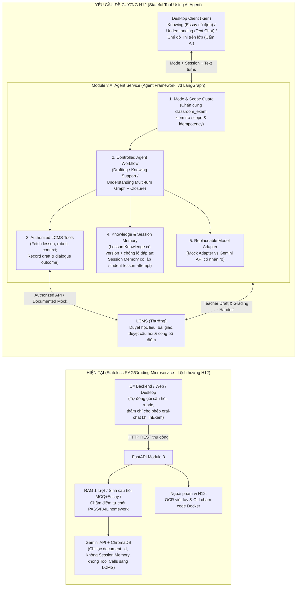

# PHÂN TÍCH VÀ ĐỐI CHIẾU DỰ ÁN HIỆN TẠI VỚI ĐỀ CƯƠNG TỐT NGHIỆP (H12. AI AGENT DEVELOPMENT)

> **Tài liệu phục vụ ra quyết định kỹ thuật** — So sánh trực tiếp giữa **Đề cương hướng dẫn H12** của TS. Nguyễn Toàn Thắng với **mã nguồn hiện tại** trong `module3-ai-agent` (v0.14.0, nhánh `ai-module`) và phần đã ghép nối với Backend/Desktop App trên nhánh `ai-integration`.  
> **Lưu ý:** Tài liệu này chỉ phân tích và đánh giá hiện trạng; **chưa chỉnh sửa bất kỳ dòng mã nguồn nào của dự án**.

---

## 1. Tổng quan & Kết luận nhanh (Executive Summary)

### 1.1. Thông tin cốt lõi của Đề cương chuẩn (H12)
- **Sinh viên:** Dương Quốc Toản (`DTC235210055`, lớp `CNTT K22B QT`) — **GVHD:** TS. Nguyễn Toàn Thắng.
- **Tên đề tài:** *Development of an AI Agent Module for an LMS/LCMS Supporting Blended Learning at the Academy of International Education* (Thời lượng: 10 tuần).
- **Hệ sinh thái phối hợp (nêu đích danh tại PI 4.2):**
  - **LCMS / Backend API** của **Thưởng** (`backend_api/`).
  - **Student Desktop Application** của **Kiên** (`student_desktop_app/`).
  - **AI Agent Module** của **Toản** (`module3-ai-agent/`).

### 1.2. Đánh giá mức độ đáp ứng hiện tại

Ước tính toàn cục theo bảng trọng số chuẩn đầu ra (CLO/PI) của Đề cương H12, dự án hiện tại mới đáp ứng khoảng **35% – 40% yêu cầu**:

| CLO | Mô tả năng lực trong Đề cương H12 | Trọng số | Mức đáp ứng ước tính | Nhận xét tóm tắt |
|---|---|---:|---:|---|
| **CLO 1** | Phân tích bài toán, luồng nghiệp vụ và ranh giới vai trò AI Agent | **20%** | ~40% | Đã tách được tính toán tất định ở backend và quy trình duyệt rubric, nhưng **sai lệch định dạng đánh giá** (có trắc nghiệm/oral), **thiếu luồng chat Understanding** và **chưa chặn chế độ thi trên lớp**. |
| **CLO 2** | Thiết kế kiến trúc Agent, Tools/APIs, Lesson Knowledge & Session Memory | **30%** | ~25% | Hiện là REST RAG/LLM **stateless**; **thiếu tầng Tool-calling gọi sang LCMS**, thiếu authorization scope & idempotency, **thiếu Session Memory cô lập** theo `(student, lesson, attempt)` và chưa phiên bản hóa tri thức bài học. |
| **CLO 3** | Hiện thực hóa hệ thống Agent tích hợp LLM, Tools & Controlled Workflow | **40%** | ~35% | Phần gọi Gemini + structured JSON + RAG chống bịa (PI 3.2) làm rất tốt, nhưng **thiếu Agent Framework** (PI 3.1), **thiếu Authorized Tool Calls nối LCMS & dialogue Understanding** (PI 3.3 = **20%**), **thiếu Controlled Workflow đa bước** (PI 3.4 = **10%**). |
| **CLO 4** | Đánh giá, kiểm thử và triển khai hệ thống | **10%** | ~50% | Hạ tầng Docker/Render/bảo mật API key rất tốt (PI 4.2), đã có 1088 tests offline & 12 ca golden grading, nhưng **thiếu 4/6 nhóm tiêu chí đánh giá của PI 4.1** và **thiếu test cô lập chéo phiên** (`cross-session isolation`). |

### 1.3. Nguyên nhân gốc rễ của sự lệch pha

Code trong `module3-ai-agent` hiện tại được xây dựng theo **đặc tả đề tài nghiên cứu khảo thí CNTT trước đó (`S2026-07-33`)** (thể hiện rõ qua `Bai_noi_va_giai_thich_Module3_AI_Agent.md`, hệ thống sinh ma trận trắc nghiệm, OCR bài viết tay, và CLI chấm code bằng Docker sandbox).

Trong khi đó, **Đề cương chính thức H12** của thầy Thắng định hướng bài toán theo **Blended Learning tại Academy of International Education** và đặt trọng tâm vào **kiến trúc AI Agent thực thụ** với 3 trụ cột nghiệp vụ duy nhất:
1. **Hỗ trợ giảng viên (`Teacher services`):** Đề xuất câu hỏi bám bài giảng (*lesson-grounded*) và gợi ý chấm điểm theo rubric (*AI chỉ gợi ý bản nháp, LCMS mới là nơi duyệt & phát hành*).
2. **Đánh giá tại nhà 2 cấp độ (`Two-level home assessment`):**
   - **Knowing:** Câu hỏi **tự luận cố định** bám bài học do giảng viên duyệt (*không được thay bằng trắc nghiệm*).
   - **Understanding:** **Hội thoại văn bản thích ứng** nhiều lượt kiểu GPT (*không được thay bằng tương tác giọng nói/oral*).
3. **Tuân thủ chế độ kiểm tra (`Classroom examination mode`):** Tôn trọng chế độ được phép và **tuyệt đối không hỗ trợ trái phép** khi sinh viên đang ở chế độ thi có kiểm soát trên lớp.

---

## 2. Dự án hiện tại ĐÃ CÓ NHỮNG GÌ? (Tài sản kỹ thuật giá trị cao có thể giữ lại)

Dù lệch pha về kiến trúc Agent và luồng nghiệp vụ, chất lượng kỹ thuật nền tảng trong `module3-ai-agent` rất tốt và **tái sử dụng được khoảng 45%–50%** cho Đề cương H12:

1. **Khung dịch vụ FastAPI & Hạ tầng vận hành Production hoàn chỉnh:**
   - Entrypoint `app/main.py`, cấu hình fail-fast `app/core/config.py`, middleware gắn `X-Request-ID` & `X-AI-Config-Fingerprint` (`app/core/middleware.py`, `app/core/runtime_config.py`).
   - Giới hạn tải & an toàn vận hành: `app/core/rate_limit.py`, `app/core/concurrency.py`, `app/core/timeouts.py`, `app/core/error_handlers.py`, `app/api/metrics.py` (Prometheus `/metrics`), `app/api/health.py`.
   - Đóng gói triển khai sẵn sàng: `Dockerfile` (multi-stage, non-root), `docker-compose.yml`, `render.yaml`.

2. **Tầng trừu tượng hóa LLM & Quản lý Gemini Quota bài bản (nền tảng tốt cho Model Adapter ở PI 3.1 & PI 3.2):**
   - `app/services/llm_service.py` tách interface trừu tượng `LLMService` khỏi `GeminiLLMService` (hỗ trợ `generate`, `generate_json`, `generate_stream`), có kiểm tra schema JSON và thử lại có kiểm soát.
   - `app/core/key_pool.py` hỗ trợ nhiều API key (`GEMINI_API_KEY=key1,key2,...`), xoay vòng round-robin và tự chuyển key dự phòng khi gặp `429` hoặc `5xx`.
   - `tests/fakes.py` cung cấp `ScriptedLLM`, `LexicalEmbedding` và `httpx.MockTransport` giúp chạy test hoàn toàn offline không cần mạng.
   - Bảo mật credential tốt: API key chỉ nằm ở server `.env`, gửi qua header `x-goog-api-key`, được `tests/test_security.py` rà soát tự động — đáp ứng yêu cầu PI 4.2 không để lộ key trong code client phân tán.

3. **Pipeline nạp học liệu (`.pdf`, `.docx`) & RAG chống ảo giác (nền tảng cho Lesson Knowledge ở PI 2.3):**
   - `app/services/document_service.py`, `pdf_service.py`, `docx_service.py`, `chunk_service.py` (phân đoạn mặc định `800/150` ký tự kèm `document_id` và số trang), `embedding_service.py` (`gemini-embedding-001`), `app/repositories/chroma_repository.py` (ChromaDB cosine).
   - Cơ chế chống bịa nghiêm ngặt (`app/services/rag_service.py`): lọc cứng theo `document_id`, ngưỡng tương đồng `0.3`; nếu không đủ ngữ cảnh thì trả `INSUFFICIENT_CONTEXT` và **không gọi LLM**; danh sách trích dẫn (`sources`, `chunk_id`, `page`) luôn do backend lấy từ ChromaDB, không tin đầu ra của LLM.

4. **Quy trình Rubric & Chấm điểm tách biệt tính toán số học (nền tảng rất tốt cho Grading Support):**
   - `app/schemas/rubric.py` và `app/grading/rubric_validator.py`: kiểm tra 6 quy tắc cấu trúc (`R1`, `R2`, `R4`, `R6`, `ID`, `PASS_RULE`), từ chối chấm nếu rubric chưa `approved` (`RUBRIC_NOT_APPROVED`).
   - `app/grading/grader.py` và `app/services/grading_service.py`: LLM chỉ chọn nhãn `level` và trích `reason`/`evidence`; mọi phép cộng điểm và kiểm tra điều kiện đều do code backend thực hiện.
   - Chống gian lận/thao túng prompt (`app/grading/flags.py`, `app/core/output_guard.py`): nhận diện mẫu Prompt Injection tiếng Việt/Anh gắn cờ `injection_suspected`, bắt lỗi bài rỗng hoặc chép lại đề (`is_empty_or_copy`), và chặn rò rỉ system prompt nguyên văn bằng kiểm tra 8-gram shingle (`enforce_no_prompt_leak`).

5. **Bước đầu kết nối từ Backend C# sang Module 3 trên nhánh `ai-integration`:**
   - Đã có `backend_api/Services/Module3Client.cs`, `backend_api/Controllers/LecturerAiController.cs`, `backend_api/Controllers/StudentAiController.cs`, `backend_api/Services/HomeworkAiGrading.cs` gọi sang các endpoint hiện tại của Module 3.

---

## 3. MƯỜI (10) SAI SÓT, MÂU THUẪN & LỖ HỔNG NGHIÊM TRỌNG SO VỚI ĐỀ CƯƠNG H12

### Nhóm A — Sai ngược quy tắc nghiệp vụ / Vi phạm điều cấm trực tiếp của Đề cương

#### Sai sót #1: Tự động chốt điểm & công bố kết quả `final` ở bài tập về nhà
- **Đề cương yêu cầu:**
  - Mục 7a: *"The LCMS remains responsible for approved content, assignments and grade publication."*
  - PI 1.3: Phải phân biệt rõ *"draft suggestions and released results"*.
  - PI 2.2: *"prohibit unrestricted data access or **silent grade publication**."*
  - Tuần 6: Chấm bài mức Knowing trả về *"Scoring suggestions with criterion-linked feedback and teacher handoff."*
- **Thực tế trong code hiện tại:**
  - Trong `module3-ai-agent/app/grading/policy.py`, ngữ cảnh `homework` chạy chế độ `pass_fail` và trả `status = "final"` nếu không có cờ lỗi; trong `app/services/grading_service.py` (hàm `build_result`), `points` và `max_points` bị ẩn thành `None` ở chế độ `homework`.
  - Trên nhánh `ai-integration`, `backend_api/Services/HomeworkAiGrading.cs` (dòng 124–139) nhận kết quả `final` rồi tự động ghi thẳng vào DB: `Result = "Pass"/"Fail"`, `GradedBy = "AI"`, công bố luôn cho sinh viên mà **không có bước giảng viên duyệt hay handoff**.
- **Hệ quả:** Vi phạm trực tiếp nguyên tắc *không tự công bố điểm ngầm* (`silent grade publication`) và *teacher handoff* của Đề cương H12.

#### Sai sót #2: Dùng Trắc nghiệm (MCQ/True-False) và thuật ngữ Vấn đáp/Oral thay cho Tự luận cố định & Chat văn bản
- **Đề cương yêu cầu (PI 1.1):**
  - *"Specify Knowing as fixed lesson-based essay assessment and Understanding as interactive text chat; **do not substitute multiple-choice testing or voice interaction**."*
- **Thực tế trong code hiện tại:**
  - `module3-ai-agent/app/schemas/question.py` và `app/api/questions.py` hỗ trợ mạnh `multiple_choice`, `true_false`, mặc định `short_answer`, và cung cấp `/api/questions/generate-matrix` để sinh ma trận đề trắc nghiệm cho Module 1 (`LecturerController` / `studio-creator`).
  - Trong `backend_api/Models/AppModels.cs` (nhánh `ai-integration`, dòng 260), `HomeAssignment.Format` đang khai báo là `"Quiz, ShortAnswer, AIOralInterview"`.
  - Trong `student_desktop_app/ApiClient.cs` (dòng 126–148) và `backend_api/Controllers/StudentController.cs` dùng endpoint `/api/student/oral-chat` (`OralChat` / `SendOralChatAsync`), hàm đặt tên là "Vấn đáp / Oral".
- **Hệ quả:** Dễ bị hội đồng bắt lỗi vi phạm trực tiếp chỉ thị *"do not substitute multiple-choice testing or voice interaction"* nếu đưa vào báo cáo H12 mà không chuẩn hóa lại.

#### Sai sót #3: Không kiểm tra chế độ thi và KHÔNG từ chối AI khi sinh viên đang thi có kiểm soát trên lớp
- **Đề cương yêu cầu:**
  - Mục 7a: *"The AI module will honor the permitted assessment mode and will not provide unauthorized assistance during classroom examinations."*
  - PI 1.2, PI 3.4, Tuần 8: Phải có *"forbidden use during controlled classroom examinations"* và bài test *"classroom-mode denial tests"*.
- **Thực tế trong code hiện tại:**
  - Toàn bộ `module3-ai-agent` không có khái niệm `assessment_mode` (ví dụ: `teacher_drafting`, `home_knowing`, `home_understanding`, `classroom_exam`) nên không có cơ chế từ chối khi gọi trong chế độ thi.
  - Đáng báo động nhất là trên nhánh `ai-integration`:
    1. `backend_api/Controllers/StudentController.cs` ở endpoint `[HttpPost("oral-chat")]` thậm chí **yêu cầu** sinh viên phải đang có `ExamSession` với `Status == "InExam"` hoặc `"Reopened"` mới cho gọi `TryOralRagFromSubjectAsync(...)` — tức là **dùng RAG của Module 3 để trả lời câu hỏi cho sinh viên ngay giữa phòng thi!**
    2. `backend_api/Controllers/StudentAiController.cs` (`[HttpPost("ai-chat")]`) gọi Module 3 RAG trả lời câu hỏi học thuật cho sinh viên mà **không hề kiểm tra** xem sinh viên đó có đang mở `ExamSession` (`InExam`) hay `ExamRoomSession` (`InProgress`) hay không.
    3. `student_desktop_app/ApiClient.cs` vẫn có hàm `SendOralChatAsync(studentId, examId, ...)` gắn với giao diện thi Desktop.
- **Hệ quả:** Đi ngược 180 độ với yêu cầu bảo vệ an toàn kỳ thi trên lớp của cả Đề cương H12 lẫn hệ thống của Thưởng/Kiên.

---

### Nhóm B — Thiếu hụt kiến trúc cốt lõi của một hệ thống AI Agent (Chiếm 70% điểm: CLO 2 + CLO 3)

#### Sai sót #4: Thiếu hoàn toàn mức đánh giá `Understanding` — Hội thoại văn bản thích ứng đa lượt kiểu GPT
- **Đề cương yêu cầu (Mục 5, 7a, PI 1.1, 1.2, 3.2, 3.3, 3.4, Tuần 7):**
  - Mức `Understanding` phải là **hội thoại văn bản thích ứng nhiều lượt** (như chat GPT): Agent lấy tài liệu & rubric của bài học, đặt câu hỏi/gợi mở, phân tích câu trả lời sinh viên theo từng lượt, quyết định câu hỏi nối tiếp (`follow-up`) phù hợp hoặc đóng phiên (`session closure`), và ghi nhận kết quả đánh giá gắn tiêu chí + bằng chứng.
- **Thực tế trong code hiện tại:**
  - Chưa có bất kỳ endpoint, schema, prompt hay state machine nào cho `Understanding` dialogue trong `module3-ai-agent` (chính `Bai_noi_va_giai_thich_Module3_AI_Agent.md` cũng xác nhận phần tác tử hội thoại chưa được tích hợp).
  - `/api/rag/answer` và `/api/student/ai-chat` chỉ là **hỏi-đáp tra cứu tài liệu 1 lượt** (sinh viên hỏi → AI trả lời), **ngược hoàn toàn chiều sư phạm của đánh giá Understanding** (Agent hỏi/đẫn dắt → sinh viên trả lời → Agent đánh giá & đào sâu).

#### Sai sót #5: Chưa sử dụng Agent Framework & Kiến trúc bị "ngược chiều" — Thiếu Authorized Tool Calls sang LCMS
- **Đề cương yêu cầu (PI 2.1, 2.2, 3.1, 3.3 — riêng PI 3.3 chiếm 20% tổng điểm):**
  - PI 3.1: Chọn và biện minh **Agent Framework**; triển khai dịch vụ & test harness với model adapter thay thế được, **phân biệt rạch ròi phản hồi mock với phản hồi model thật**.
  - PI 2.1, 2.2, 3.3: Agent kết nối **Authorized Tools** để gọi sang các dịch vụ LCMS (lấy nội dung bài học được phép, câu hỏi/rubric, ngữ cảnh đánh giá; và ghi lại gợi ý đánh giá, kết quả hội thoại). Có thể dùng LCMS thật hoặc Mock LCMS được tài liệu hóa.
- **Thực tế trong code hiện tại:**
  - **Không có Agent Framework:** `requirements.txt` chỉ gồm `fastapi`, `uvicorn`, `pydantic`, `chromadb`, `httpx`, `PyMuPDF`, `python-docx`. Mỗi API là một hàm REST tuyến tính cứng, không có vòng lặp Agent suy luận/chọn tool. Thư mục `agent/` hiện tại chỉ là **CLI script chấm code nộp bài** (`python -m agent scan/grade/export`), không phải thư viện Agent Framework điều phối hội thoại và tool calls.
  - **Kiến trúc ngược chiều Tool-Calling:** Hiện tại Module 3 bị động hoàn toàn ("mù" về LCMS). Phía C# (`LecturerAiController.cs`, `HomeworkAiGrading.cs`) phải tự đọc DB, tự đóng gói toàn bộ `question`, `expected_answer`, `rubric`, `document_ids` nhét vào HTTP body gửi sang Module 3. Module 3 **không có bất kỳ công cụ/adapter nào** để tự gọi sang LCMS (hoặc Mock LCMS) truy xuất dữ liệu được ủy quyền hay ghi nhận kết quả đề xuất.
  - **Chưa tách nhãn Mock vs Live ở cấp dịch vụ:** `tests/fakes.py` chỉ dùng trong `pytest`, chưa có cấu hình runtime (như `MODEL_ADAPTER=mock|gemini`, `LCMS_ADAPTER=mock|http`) kèm trường đánh dấu tường minh trong response/log để demo phân biệt mock vs model thật theo PI 3.1.

#### Sai sót #6: Thiếu phân quyền phạm vi (`Authorization Scope`), định danh ổn định (`Stable Identifiers`) và chống gửi lặp (`Idempotency`)
- **Đề cương yêu cầu (PI 1.3, PI 2.2):**
  - Phân định quyền hạn và danh sách tool được phép cho từng vai trò (`question-drafting`, `grading-support`, `dialogue-assessment`).
  - Các tool/API phải có **định danh ổn định** (`stable identifiers`), schema rõ ràng, **phạm vi ủy quyền** (`authorization scope`), phản hồi lỗi chuẩn và **xử lý request lặp lại** (`repeated-request handling`); cấm truy cập dữ liệu không giới hạn.
- **Thực tế trong code hiện tại:**
  - `docs/SECURITY.md` (dòng 3–4) nêu rõ: *"There is no authentication or authorisation on the API"*. Bất kỳ caller nào gọi cổng `8003` đều gọi được mọi endpoint, không có token/scope phân biệt chức năng soạn đề của giảng viên với phiên làm bài của sinh viên.
  - `docs/INTEGRATION_CONTRACT.md` (dòng 52–53) quy định mỗi lần gọi `/api/documents/upload` sẽ sinh ra một `document_id` UUID4 mới ngẫu nhiên (upload cùng 1 file 2 lần tạo 2 tài liệu độc lập). Module 3 cũng chưa quản lý `lesson_id`, `assignment_id`, `student_id`, `attempt_id`, chưa có `Idempotency-Key` hay khóa duy nhất `(session_id, turn_index)` để chống trùng lặp khi mạng lỗi/client retry.

#### Sai sót #7: Thiếu Session Memory cô lập theo `(student, lesson, attempt)`, thiếu phiên bản hóa tri thức và có rủi ro lộ đáp án mẫu
- **Đề cương yêu cầu (PI 2.3):**
  - Thiết kế **tri thức bài học có phiên bản** (*versioned knowledge*) dựa trên tài liệu & rubric đã được giảng viên phê duyệt.
  - Thiết kế **bộ nhớ phiên (`session memory`) cô lập theo từng sinh viên, bài học và lượt làm bài** (*isolated by student, lesson and attempt*), có chính sách lưu giữ/cắt tỉa ngữ cảnh (*retention/context policy*) và lưu tham chiếu bằng chứng (*evidence references*).
  - **Ngăn chặn đáp án mẫu (`answer keys`) hoặc hội thoại của sinh viên khác rò rỉ qua ngữ cảnh truy xuất.**
- **Thực tế trong code hiện tại:**
  - Dịch vụ hiện tại 100% **stateless** — không có database/store lưu trạng thái phiên (`active`, `closed`), lịch sử hội thoại theo lượt, hay chính sách retention.
  - `app/repositories/chroma_repository.py` chỉ lưu metadata `document_id`, `chunk_id`, `page`, `source`, `embedding_model`. Hoàn toàn **chưa có** `lesson_id`, `knowledge_version`, `approved_status`, và **không phân tách phạm vi hiển thị (`teacher_only` vs `student_safe`)**. Nếu giảng viên nạp tài liệu có kèm đáp án/hướng dẫn chấm hoặc khi chạy chat `Understanding`, không có lớp lọc ngăn đáp án mẫu lọt vào ngữ cảnh trả về cho sinh viên.

#### Sai sót #8: Thiếu Controlled Workflow đa bước, thiếu truy vết Tool Outcome và thiếu kịch bản kiểm thử bảo mật hội thoại
- **Đề cương yêu cầu (PI 3.4 — chiếm 10% tổng điểm):**
  - Hiện thực hóa luồng điều phối có kiểm soát: *xác thực chế độ & phiên → truy xuất bằng chứng → chọn tool được phép → đánh giá câu trả lời → chọn câu hỏi tiếp theo hoặc đóng phiên*.
  - Ghi nhận được chuỗi hành động quan sát được, bằng chứng và kết quả thực thi tool (*observable actions, evidence and tool outcomes*).
  - Kiểm thử các nỗ lực: (1) lái hướng agent (*redirect the agent*), (2) dụ tiết lộ đáp án (*reveal answers*), (3) sửa điểm (*alter scores*), (4) cố chat tiếp sau khi phiên đã đóng (*continue after closure*). Không phụ thuộc vào chuỗi suy luận ẩn (*hidden model reasoning*).
- **Thực tế trong code hiện tại:**
  - `app/core/execution_trace.py` mới chỉ ghi một dòng log tổng hợp cấu hình cho mỗi HTTP request (`task`, `config_fingerprint`, `source_chunk_ids`), chưa ghi chuỗi hành động từng bước của Agent hay kết quả gọi từng tool.
  - Mới chỉ kiểm thử kịch bản (3) **sửa điểm** (`alter scores` trong `tests/golden/grading_acid.yaml` và `tests/test_security.py`), **thiếu hoàn toàn 3 kịch bản còn lại**: dụ lộ đáp án, lái hướng hội thoại, và gửi tin nhắn sau khi đóng phiên.

---

### Nhóm C — Không nhất quán kỹ thuật, Lệch phạm vi & Thiếu hụt kiểm chứng thực nghiệm

#### Sai sót #9: Tồn tại song song endpoint chấm cũ không theo Rubric và mã lỗi mang tên `OLLAMA_*`
- **Thực tế trong code:**
  - `app/api/evaluations.py` (`/api/evaluations/evaluate` và `/evaluate/stream`) vẫn đang mở công khai, cho phép LLM tự trả trực tiếp con số `score` mà không cần rubric `approved` — đi ngược hoàn toàn với triết lý kiểm soát rubric của `/api/grading/grade`.
  - `app/api/health.py` vẫn trả `"ollama": true`, `services.ollama`; `app/core/exceptions.py` vẫn dùng chuỗi mã lỗi `OLLAMA_UNAVAILABLE`, `OLLAMA_TIMEOUT`, `OLLAMA_GENERATION_ERROR`, `OLLAMA_MODEL_NOT_FOUND` dù dự án đã chuyển hoàn toàn sang Google Gemini API.
- **Rủi ro khi viết báo cáo & bảo vệ:** Nếu không làm sạch hoặc tách rõ, hội đồng rất dễ chất vấn về sự mâu thuẫn giữa hai cơ chế chấm điểm và kiến trúc provider thực tế.

#### Sai sót #10: Nhiều tính năng nặng không nằm trong Đề cương H12 + Bộ đánh giá PI 4.1 còn thiếu 4/6 mảng
- **Tính năng ngoài phạm vi H12 (đã mất công làm nhưng không có điểm trong bảng PI):**
  - OCR bài làm viết tay bằng Gemini Vision (`app/api/submissions.py` — `/api/submissions/handwritten/transcribe`).
  - CLI Grading Agent chấm bài nộp lập trình zip/folder + Docker sandbox (`module3-ai-agent/agent/*`).
  - Sinh ma trận đề trắc nghiệm (`/api/questions/generate-matrix` với `multiple_choice`/`true_false`).
- **Khoảng trống của bộ đánh giá (PI 4.1):**
  - Đề cương yêu cầu bộ kiểm thử do GVHD duyệt bao phủ **6 khía cạnh**: *(1) question relevance, (2) lesson grounding, (3) rubric coverage, (4) scoring agreement, (5) Understanding follow-up quality, (6) failure handling*, kèm **prompt-injection** và **cross-session isolation tests**, phải thống nhất kích thước tập mẫu và ngưỡng chấp nhận trước khi báo cáo kết quả.
  - Hiện tại `module3-ai-agent` mới chỉ có:
    - `scripts/evaluate_rag.py` + `tests/data/rag_eval.json`: 10 câu RAG retrieval offline (`Hit@5`, `Precision@5`, `Recall@5` trên 2 đoạn văn bản mẫu tiếng Anh).
    - `scripts/prompt_eval.py` + `tests/golden/grading_acid.yaml` + `reports/prompt_eval_after.md`: 12 ca chấm bài trên **duy nhất 1 câu hỏi ACID**, lặp 2 lần (`MAE = 0.50`, `Homework PASS/FAIL = 100%`, `Stability = 91%`).
  - Hoàn toàn **chưa có** đánh giá chất lượng câu hỏi soạn (`question relevance`), độ phủ rubric (`rubric coverage`), chất lượng hỏi xoáy Understanding (`follow-up quality`), kiểm thử cô lập chéo phiên (`cross-session isolation`), và bộ mẫu đánh giá đa bài học được thầy Thắng thông qua.

---

### Sơ đồ so sánh trực quan Kiến trúc hiện tại vs Kiến trúc Đề cương H12

---

## 4. Bảng ma trận đối chiếu chi tiết toàn bộ 12 chỉ số PI & Lịch trình 10 tuần

### 4.1. Đối chiếu theo 12 Performance Indicators (PI 1.1 → PI 4.2)

| Mã PI (% điểm) | Yêu cầu tối thiểu trong Đề cương H12 | Hiện trạng trong dự án hiện tại | Trạng thái | Việc cần làm nếu quyết định sửa |
|---|---|---|---:|---|
| **PI 1.1 (5%)** | Chỉ rõ chỗ dùng Agent/Tool cho soạn câu hỏi bám bài, hỗ trợ chấm, chat Understanding vs hàm LCMS tất định. Knowing = **essay cố định**, Understanding = **text chat** (*cấm thay bằng trắc nghiệm / voice*). | Đã tách phần tính điểm tất định khỏi LLM; **nhưng** đang hỗ trợ trắc nghiệm (`multiple_choice`, `true_false`, ma trận đề), dùng tên `oral-chat`/`AIOralInterview` và chưa có mức `Understanding` text chat. | ⚠️ Lệch | Chuẩn hóa đặc tả & luồng nghiệp vụ: Knowing = fixed essay, Understanding = adaptive text chat; tách/ngừng dùng MCQ & oral cho 2 mức này. |
| **PI 1.2 (5%)** | Mô hình hóa đầy đủ quy trình GV (soạn/duyệt/phát hành/chấm) & SV (giao bài, nộp essay, lượt hội thoại, đóng phiên, phản hồi), gồm recovery và **cấm dùng khi thi trên lớp**. | Đã có phần rubric draft→validate→approved và nộp homework; **nhưng** thiếu luồng chat/closure và trên `ai-integration` lại cho phép `oral-chat` trong khi `InExam`. | ❌ Chưa đạt | Bổ sung sơ đồ & logic đầy đủ cho cả luồng Understanding và quy tắc chặn cứng `classroom_exam`. |
| **PI 1.3 (10%)** | Định nghĩa trách nhiệm & quyền hạn của 3 chức năng (question-drafting, grading-support, dialogue-assessment), allowed tools, stopping conditions, escalation và **draft suggestions vs released results**. | Đã có cờ đẩy sang GV (`needs_review`, `pending_review`) cho in-class và bài có cờ; **nhưng** homework vẫn tự chốt `final` và chưa định nghĩa allowed tools / stopping conditions / escalation cho dialogue. | ⚠️ Thiếu nhiều | Sửa chính sách để mọi kết quả AI chỉ là `draft_suggestion` bàn giao LCMS; đặc tả rõ role, allowed tools, điều kiện dừng & chuyển GV. |
| **PI 2.1 (15%)** | Thiết kế kiến trúc Agent nối LCMS, LLM, Tool execution, Lesson Knowledge, Per-student Sessions; giữ ranh giới tường minh (data access, model context, orchestration, validation); dùng mock nếu tích hợp chưa sẵn sàng. | Đã tách lớp Service / Repository / Validator trong FastAPI; **nhưng** chưa phải kiến trúc Agent, không có Tool layer sang LCMS, không có Session layer, không có Mock LCMS. | ❌ Chưa đạt | Thiết kế lại kiến trúc phân lớp chuẩn Agent (Gateway/Guard → Agent Orchestrator → Tool Layer → Knowledge & Session Store → Model Adapter). |
| **PI 2.2 (10%)** | Đặc tả Tools/APIs lấy lesson, questions/rubrics, assessment context và ghi suggestions, dialogue outcomes. Có **stable IDs, schemas, auth scope, failure responses, repeated-request handling**; cấm unrestricted access & silent grade publication. | Đã có JSON schemas và bộ mã lỗi chuẩn ở REST API; **nhưng** API không có auth/scope, `document_id` sinh ngẫu nhiên không ổn định, không có idempotency, và cho phép tự chốt điểm homework. | ❌ Chưa đạt | Thêm Tool contracts chuẩn, xác thực service token + scope theo vai trò, hỗ trợ `Idempotency-Key` và ID ổn định (`lesson_id`, `attempt_id`), bỏ auto-publish điểm. |
| **PI 2.3 (5%)** | Tri thức bài học có **phiên bản** từ học liệu & rubric đã duyệt + **session memory cô lập theo `(student, lesson, attempt)`**, lưu evidence refs, có retention/context policy; **chống lộ answer key hoặc chat của SV khác**. | ChromaDB lọc tốt theo `document_id` và lưu `chunk_id`/`page`; **nhưng** thiếu `lesson_id`, `knowledge_version`, phân loại `answer_key` vs tài liệu cho SV, và không có Session Memory. | ❌ Chưa đạt | Thêm metadata version & visibility trong ChromaDB; xây dựng `SessionStore` (SQLite) khóa theo `(student_id, lesson_id, attempt_id)` + chính sách cửa sổ ngữ cảnh. |
| **PI 3.1 (5%)** | Chọn và biện minh **Agent Framework**; cấu hình tái lập với model adapter thay thế được; dịch vụ & test harness chạy được, **phân biệt rõ mock response với actual model response**. | Đã có `LLMService` trừu tượng + `tests/fakes.py` cho pytest và config fingerprint; **nhưng** chưa dùng Agent Framework và dịch vụ runtime chưa có chế độ mock gắn nhãn tường minh. | ⚠️ Một phần | Tích hợp Agent Framework (ví dụ **LangGraph** hoặc **PydanticAI**), bổ sung runtime `mock` model adapter + nhãn `adapter_mode: "mock"|"live"` rõ ràng. |
| **PI 3.2 (5%)** | Tích hợp LLM qua structured prompts & validated output schemas cho question drafts, rubric suggestions, dialogue turns; xử lý lỗi dịch vụ, malformed answers, context limits mà không tự bịa điểm/hoàn thành phiên. | Làm rất tốt cho question/rubric/grading (`prompt_registry.py`, `safe_parse_json`, retry 1 lần, trả mã lỗi chuẩn thay vì bịa điểm); **chỉ thiếu** phần `dialogue turns` và ngưỡng context hội thoại. | ✅ Gần đạt (thiếu dialogue) | Bổ sung prompt có phiên bản và schema JSON có kiểm duyệt cho lượt hội thoại Understanding + xử lý cắt/tóm tắt khi chạm giới hạn context. |
| **PI 3.3 (20%)** | Thực thi **authorized tool calls** kết nối dịch vụ lesson/rubric/assignment & result-suggestion của LCMS; demo đủ: question drafting, Knowing assessment, Understanding text dialogue (qua tích hợp thật hoặc documented mocks). | **Lỗ hổng lớn nhất về điểm số:** Module 3 chưa có bất kỳ Tool call nào sang LCMS, chưa có Understanding dialogue, mới chỉ có REST endpoints rời rạc được C# gọi một chiều. | ❌ Thiếu cốt lõi | Xây dựng `LCMSToolClient` (`http` cho backend của Thưởng + `mock` có tài liệu hóa) nối 3 kịch bản end-to-end: soạn đề, chấm Knowing suggestion, chat Understanding. |
| **PI 3.4 (10%)** | Controlled workflow: validate mode & session → retrieve evidence → select allowed tools → evaluate answer → follow-up hoặc close session. Ghi observable actions/evidence/tool outcomes; test redirect, reveal answers, alter scores, continue after closure. | Mới có validate input + detect injection sửa điểm (`grading_acid.yaml`) và log config ở cấp request; **chưa có** state machine workflow, log từng tool step, và 3 bài test bảo mật hội thoại còn lại. | ❌ Chưa đạt | Hiện thực hóa state graph kiểm soát mode/session + bảng `AgentActionTrace`; viết đủ 4 bộ test tấn công/biên (redirect, leak answer, alter score, post-closure). |
| **PI 4.1 (5%)** | Bộ đánh giá được GVHD duyệt cho 6 tiêu chí + prompt-injection & cross-session isolation tests; thống nhất kích thước mẫu & ngưỡng trước khi báo cáo kết quả và hạn chế. | Mới có 10 mẫu RAG offline + 12 ca chấm điểm bài ACID (`reports/prompt_eval_after.md`); **thiếu 4/6 tiêu chí**, chưa có test cô lập chéo phiên, chưa chốt mẫu với GVHD. | ⚠️ Thiếu nhiều | Thiết kế tập đánh giá 6 nhóm (đa bài học, có cả hội thoại Understanding & isolation test), gửi thầy Thắng duyệt size/ngưỡng rồi chạy đo thật. |
| **PI 4.2 (5%)** | Triển khai agent service kèm cấu hình, giới hạn vận hành, hướng dẫn cài đặt/sử dụng, bằng chứng tích hợp với **LCMS của Thưởng** & **Desktop client của Kiên**; không nhúng credential model vào client. | Docker/Render/README/INTEGRATION_CONTRACT/SECURITY đã rất bài bản và bảo mật key tốt; tích hợp trên `ai-integration` mới là bản đầu chưa theo chuẩn Agent H12. | ⚠️ Nền tốt, tích hợp cũ | Cập nhật tài liệu cài đặt/API mới, bổ sung test & bằng chứng tích hợp sạch với `backend_api` (Thưởng) và `student_desktop_app` (Kiên). |

### 4.2. Vị trí hiện tại so với Lịch trình 10 tuần (Mục 9 của Đề cương)

- **Tuần 1–3 (Phân tích, đặc tả API/scope/session states, thiết kế kiến trúc Agent & Memory):** Chưa hoàn chỉnh theo H12 (mới chỉ có đặc tả REST cũ trong `INTEGRATION_CONTRACT.md`).
- **Tuần 4 (Framework + Replaceable Model Adapter + Authorized Retrieval):** Mới xong phần Model Adapter & Retrieval cục bộ; **thiếu Framework & Authorized LCMS Retrieval**.
- **Tuần 5 (Lesson-grounded Question Drafting + Teacher Handoff):** Đã làm ~70% ở phần sinh câu & source chunks; cần bỏ/tách MCQ, gắn `lesson_id`/version và thêm handoff sang LCMS.
- **Tuần 6 (Knowing Essay Grading Support + Teacher Handoff):** Đã làm ~80% lõi chấm Rubric rất tốt; cần sửa policy `homework` để không tự chốt `final` (trả gợi ý kèm điểm tiêu chí để bàn giao GV).
- **Tuần 7 (Understanding Adaptive Text Chat + Follow-up + Session Closure):** **0%** — chưa làm.
- **Tuần 8 (Tích hợp với LCMS của Thưởng & Desktop Client của Kiên + Isolation & Classroom-mode Denial Tests):** Đang lệch (trên `ai-integration` lại cho phép chat khi `InExam` và tự chấm chốt `homework`).
- **Tuần 9–10 (Chạy full evaluation set, báo cáo đo lường, deploy & khóa luận 4 chương):** Chưa đủ dữ liệu đo cho 6 hạng mục của H12 và chưa có báo cáo học thuật 4 chương.

---

## 5. Phân tích "Có nên làm tiếp / chỉnh sửa theo Đề cương H12 không?"

### 5.1. Rủi ro nếu GIỮ NGUYÊN code hiện tại để bảo vệ theo Đề cương H12
Nếu giữ nguyên code `module3-ai-agent` hiện tại mà không điều chỉnh:
- **Rủi ro mất điểm trực diện (khoảng 50%–60% trọng số PI):**
  - **PI 3.3 (20%):** Không có Authorized Tool calls sang LCMS và không demo được `Understanding` text dialogue.
  - **PI 3.4 (10%):** Không có Controlled workflow, log tool outcomes và kiểm thử đóng phiên / chống lộ đáp án.
  - **PI 2.1–2.3 (30%):** Kiến trúc chỉ là stateless REST microservice, thiếu Agent design, thiếu scope/idempotency, thiếu Session Memory cô lập.
  - **PI 1.1–1.3 (20%):** Bị bắt lỗi dùng trắc nghiệm/oral và để AI tự công bố kết quả `homework` thay vì chỉ gợi ý.
- Trong buổi bảo vệ hoặc chấm tiến độ, nếu hội đồng đối chiếu từng dòng **Bảng Mục 7b** (PI 1.1 → 4.2) trong đề cương của thầy Thắng với mã nguồn đang chạy, sự chênh lệch này rất khó giải trình chỉ bằng lời.

### 5.2. Nếu QUYẾT ĐỊNH LÀM (Nâng cấp trên nền `module3-ai-agent` hiện có)

**Tin vui lớn nhất:** Bạn **KHÔNG phải đập đi làm lại từ đầu**. Lõi khó nhất của hệ thống AI (FastAPI production skeleton, `LLMService` + `GeminiKeyPool`, PDF/DOCX chunking, ChromaDB cosine retrieval chống ảo giác, hệ thống Rubric `R1..R6`, thuật toán chấm tách điểm số học khỏi LLM, Docker, bộ test `1088` cases) **đều đã chạy ổn định và giữ nguyên được**.

**Điểm thuận lợi cực kỳ quan trọng trong đề cương của thầy Thắng:**  
Ở cả **PI 2.1** (*"use mocks for unavailable integrations"*) và **PI 3.3** (*"through the student-client/LCMS integration or documented mocks"*), thầy Thắng **cho phép dùng Mock được tài liệu hóa** cho các phần tích hợp từ LCMS/Desktop App chưa sẵn sàng. Điều này giúp bạn **hoàn toàn chủ động tự bảo vệ điểm số Module 3** mà không bị kẹt chết nếu Thưởng hoặc Kiên bận sửa chưa kịp!

#### Ước lượng khối lượng công việc nếu quyết định nâng cấp (5 gói việc chính)

1. **Gói 1 — Bổ sung Agent Framework & Labeled Model Adapter (~1.5–2 ngày):**
   - Cài đặt **LangGraph** (khuyến nghị mạnh vì kiểm soát trạng thái tường minh, khớp hoàn toàn với PI 3.4 *stateful controlled workflow*, không ép ẩn reasoning, bọc trực tiếp lên `LLMService` sẵn có của bạn) hoặc **PydanticAI**.
   - Tạo cấu hình `MODEL_ADAPTER=gemini|mock` và trả rõ cờ `adapter_mode` / `is_mock` trong `trace` của mọi response để đáp ứng PI 3.1.
   - Đánh dấu deprecated hoặc tách biệt `/api/evaluations/evaluate` (chấm không rubric) và dọn các tên `OLLAMA_*` trong phần API Agent mới để tránh mâu thuẫn khi viết Chương 3.

2. **Gói 2 — Xây dựng tầng Authorized LCMS Tools + Scope Guard + Idempotency (~2–3 ngày):**
   - Viết `LCMSToolClient` theo Interface chung có 2 implementation: `HttpLcmsToolClient` (gọi sang API nội bộ của Thưởng) và `MockLcmsToolClient` (in-memory/SQLite có seed bài học, rubric, trạng thái thi để test & demo độc lập).
   - Hiện thực hóa tối thiểu 6 Authorized Tools theo đúng PI 2.2 & PI 3.3:
     - Nhóm đọc có phạm vi: `fetch_authorized_lesson`, `fetch_approved_questions_rubric`, `fetch_assessment_context` (trả về `assessment_mode`, `allowed`, `lesson_version`, `attempt_id`).
     - Nhóm ghi nháp/gợi ý: `record_question_draft`, `record_grading_suggestion`, `record_dialogue_outcome` (hỗ trợ `Idempotency-Key` để gửi lặp không sinh bản ghi trùng).
   - Thêm xác thực Service Token + Authorization Scope theo 3 nhóm vai trò (`question_drafting`, `grading_support`, `dialogue_assessment`) và **chốt chặn `classroom_exam`**: nếu `assessment_mode == "classroom_exam"` thì từ chối ngay (`403 ASSESSMENT_MODE_FORBIDDEN`) trước khi gọi RAG/LLM.

3. **Gói 3 — Phiên bản hóa Lesson Knowledge & Isolated Session Memory (~2 ngày):**
   - Mở rộng metadata khi index lên ChromaDB (`chroma_repository.py`): gắn `lesson_id`, `knowledge_version`, `approved` và `visibility` (`student_safe` vs `teacher_only` — đảm bảo câu hỏi/đáp án mẫu hoặc tài liệu nội bộ GV **không bao giờ lọt vào kết quả truy xuất** của sinh viên).
   - Thêm `SessionMemoryStore` (dùng SQLite nhẹ trong `./data/sessions.db`): khóa duy nhất theo `(student_id, lesson_id, attempt_id)`, lưu trạng thái (`active`, `closed`, `escalated`), số lượt (`turn_count`, giới hạn `max_turns`), danh sách tiêu chí rubric đã chạm/chưa chạm, lịch sử lượt chat có chính sách giữ lại N lượt gần nhất + tóm tắt (`retention/context policy`), và danh sách `evidence_refs`.

4. **Gói 4 — Hoàn thiện 3 Agent Workflows chuẩn Đề cương (~3–4 ngày):**
   - **Workflow 1 (Teacher Question Drafting):** Agent gọi tool lấy bài học đã duyệt → truy xuất ChromaDB theo `lesson_id` & `knowledge_version` → sinh câu hỏi **tự luận (`essay`)** + ý chính chấm điểm + dẫn chứng chunk → gọi tool `record_question_draft` bàn giao LCMS chờ GV duyệt.
   - **Workflow 2 (Knowing Fixed Essay Grading Support):** Sửa `app/grading/policy.py` (hoặc thêm context `knowing_essay`) để **luôn trả gợi ý điểm theo từng tiêu chí + tổng điểm gợi ý + nhận xét + cờ review (`draft_suggestion`, `teacher_handoff: true`)**; cập nhật lại `HomeworkAiGrading.cs` trên `ai-integration` để không tự động ghi đè `Result = "Pass"/"Fail"` khi chưa có xác nhận GV.
   - **Workflow 3 (Understanding Adaptive Text Chat):** Xây dựng đồ thị trạng thái LangGraph cho các endpoint `/api/agent/understanding/sessions` (tạo phiên), `/turns` (nộp lượt trả lời của SV), `/close` (đóng phiên chủ động/tự động):
     - Bước 1: Kiểm tra scope, chế độ (`!= classroom_exam`), trạng thái phiên (`!= closed`).
     - Bước 2: Truy xuất tri thức `student_safe` liên quan đến câu trả lời của SV + đọc tiến độ các tiêu chí rubric từ `SessionMemoryStore`.
     - Bước 3: LLM đánh giá mức hiểu hiện tại của SV theo JSON schema → Agent quyết định `follow_up` (hỏi đào sâu vào tiêu chí còn hổng, tuyệt đối không tiết lộ đáp án mẫu) hoặc `close_session` (khi đủ bằng chứng hoặc hết lượt tối đa).
     - Bước 4: Ghi `AgentActionTrace` (tool nào được gọi, kết quả, bằng chứng), cập nhật session memory, và khi đóng phiên thì gọi `record_dialogue_outcome` gửi gợi ý đánh giá về LCMS.

5. **Gói 5 — Đồng bộ tích hợp với Thưởng/Kiên, mở rộng bộ đánh giá 6 tiêu chí & viết báo cáo (~3–4 ngày):**
   - **Phối hợp nhánh `ai-integration` (`backend_api` + `student_desktop_app`):**
     - Bỏ/chặn `TryOralRagFromSubjectAsync` và `[HttpPost("oral-chat")]` khi sinh viên đang `InExam` trong `StudentController.cs`.
     - Chặn `/api/student/ai-chat` nếu tài khoản sinh viên đang có `ExamSession.Status == "InExam"` hoặc `ExamRoomSession.Status == "InProgress"`.
     - Trên `student_desktop_app` của Kiên: tách rõ giao diện/chế độ làm bài tại nhà (`Knowing` essay & `Understanding` text chat) khỏi `ExamForm`/`ExamKioskForm` (chế độ thi trên lớp bị khóa AI).
   - **Mở rộng bộ kiểm thử đánh giá (PI 4.1 & PI 3.4):**
     - Bổ sung test cô lập 2 sinh viên (`cross-session isolation`), test dụ Agent tiết lộ đáp án (`reveal_answer`), test bẻ hướng hội thoại (`redirect_agent`), test gửi tin sau khi đóng phiên (`post_closure`), test từ chối chế độ thi trên lớp (`classroom_mode_denial`).
     - Chuẩn bị tập dữ liệu đánh giá cho đủ 6 tiêu chí PI 4.1 (gợi ý 2–3 bài học thực tế của Học viện/khoa để xin thầy Thắng chốt kích thước & ngưỡng).
   - **Xử lý code ngoài phạm vi (`handwritten OCR`, `CLI code sandbox`, `generate-matrix` MCQ):** Không nhất thiết phải xóa khỏi repo nếu nhóm muốn giữ lại làm công cụ bổ sung, nhưng **đóng băng và tách khỏi tài liệu/kiến trúc chính của đồ án H12** để không làm loãng hoặc vi phạm PI 1.1.

> **Tổng thời gian ước tính để chuyển đổi hoàn chỉnh phần kỹ thuật:** Khoảng **10 – 14 ngày làm việc tập trung** (vì tận dụng được toàn bộ lõi FastAPI, Gemini, ChromaDB và Rubric Engine sẵn có).

---

## 6. Danh mục câu hỏi cần chốt với GVHD (TS. Nguyễn Toàn Thắng) và nhóm (Thưởng & Kiên) trước khi làm

Nếu bạn quyết định nâng cấp dự án theo đúng Đề cương H12, nên trao đổi và chốt ngay 5 điểm sau để tránh làm lại lần thứ ba:

1. **Với thầy Thắng (Lựa chọn công nghệ — Mục 7a & PI 3.1):** Thầy có đồng ý lựa chọn **LangGraph + Google Gemini API (`gemini-3.5-flash-lite` / `gemini-embedding-001`) + ChromaDB + SQLite Session Store** cho Module 3 không?
2. **Với thầy Thắng (Tập dữ liệu & Ngưỡng đánh giá — PI 4.1):** Kích thước bộ test tối thiểu (ví dụ: bao nhiêu bài học, bao nhiêu câu hỏi soạn, bao nhiêu bài essay Knowing, bao nhiêu phiên chat Understanding) và ngưỡng chấp nhận cụ thể cho 6 tiêu chí là bao nhiêu? Học liệu mẫu dùng môn học cụ thể nào của Academy of International Education (tiếng Anh hay tiếng Việt)?
3. **Với thầy Thắng (Vai trò của code cũ):** Phần **chấm code CLI Docker sandbox** và **OCR bài viết tay** có được giữ làm phụ lục mở rộng ngoài phạm vi chấm chính không, hay nên tách hẳn khỏi nhánh nộp đồ án H12?
4. **Với Thưởng (`backend_api`):** Thưởng sẽ cung cấp các endpoint LCMS nội bộ nào để Module 3 gọi Tool (lấy bài học đã duyệt, câu hỏi/rubric, kiểm tra chế độ `classroom_exam`, nhận `draft_suggestion`), hay trong giai đoạn đầu Module 3 sẽ dùng `MockLcmsToolClient` theo contract thống nhất trước rồi Thưởng nối vào sau? Ngoài ra, cần thống nhất bỏ cơ chế `HomeworkAiGrading.cs` tự chốt `Result = Pass/Fail` và chặn `oral-chat`/`ai-chat` khi `InExam`.
5. **Với Kiên (`student_desktop_app`):** Giao diện sinh viên làm bài tại nhà (`Knowing` essay & `Understanding` text chat) sẽ đặt trên `student_desktop_app` hay cả trên `student_web.html`, và Kiên sẽ gửi cờ `assessment_mode` / `session_id` / `attempt_id` nào để đảm bảo Desktop App tách biệt hoàn toàn chế độ tự học ở nhà với `ExamKioskForm` khi thi trên lớp?
