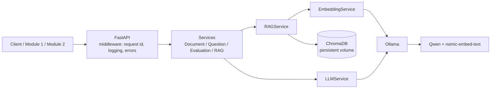

# ICTU AI Learning System — Module 3

AI backend of the ICTU AI Learning System: PDF indexing, RAG retrieval, question generation,
answer evaluation and streaming evaluation, powered by **Ollama + Qwen** and **ChromaDB**.

## Table of contents
1. [Overview](#1-overview) · 2. [Architecture](#2-architecture) · 3. [Requirements](#3-requirements) ·
4. [Local setup](#4-local-setup) · 5. [Docker setup](#5-docker-setup) · 6. [Ollama setup](#6-ollama-setup) ·
7. [Environment variables](#7-environment-variables) · 8. [API endpoints](#8-api-endpoints) ·
9. [RAG pipeline](#9-rag-pipeline) · 10. [Question generation](#10-question-generation) ·
11. [Answer evaluation](#11-answer-evaluation) · 12. [Streaming](#12-streaming-sse) ·
13. [Error handling](#13-error-handling) · 14. [Testing](#14-testing) · 15. [Benchmark](#15-benchmark) ·
16. [RAG evaluation](#16-rag-evaluation) · 17. [Docker persistence](#17-docker-persistence) ·
18. [Troubleshooting](#18-troubleshooting) · 19. [Security](#19-security) · 20. [Limitations](#20-limitations)

---

## 1. Overview

Module 3 is the AI service of the platform:

- **Module 1** uploads course PDFs to it (`POST /api/documents/upload`).
- **Module 2** asks it to evaluate student answers (`POST /api/evaluations/evaluate`).

What it does:

| Capability | Summary |
|---|---|
| **RAG** | Extracts text from a PDF, chunks it, embeds the chunks, stores them in ChromaDB and retrieves the most relevant chunks for a question. |
| **Question generation** | Asks Qwen for exam questions grounded in the retrieved document content. |
| **Answer evaluation** | Scores a student answer (0..`max_score`) with feedback, strengths, missing points and document sources. |
| **Streaming** | The same evaluation as Server-Sent Events (status → tokens → result → done). |

All answers are grounded in the uploaded document: if the document does not contain enough
information the service says so (`INSUFFICIENT_CONTEXT`) instead of letting the model guess.

## 2. Architecture



Layers: `app/api` (routers) → `app/services` (business logic) → `app/repositories`
(ChromaDB only here) ; `app/core` (config, errors, logging, middleware) ; `app/schemas` (Pydantic) ;
`app/utils`. RAG logic depends on the abstract `LLMService`, never on Ollama directly.

## 3. Requirements

- Python **3.11+**
- Docker + Docker Compose v2 (for the container setup)
- [Ollama](https://ollama.com) (only for running **without** Docker)
- Models: **Qwen** (default `qwen2.5:7b`) and **`nomic-embed-text`**
- Disk/RAM: a 7B model needs roughly 5 GB disk and 8 GB RAM; a GPU is optional but much faster.

## 4. Local setup

```powershell
cd module3-ai-agent
python -m venv .venv
.\.venv\Scripts\Activate.ps1          # Linux/macOS: source .venv/bin/activate
pip install -r requirements.txt
copy .env.example .env                # Linux/macOS: cp .env.example .env

ollama serve                          # in another terminal, if not already running
ollama pull qwen2.5:7b
ollama pull nomic-embed-text

uvicorn app.main:app --reload --host 0.0.0.0 --port 8003
```

Open <http://localhost:8003/docs> (Swagger) and <http://localhost:8003/health>.

## 5. Docker setup

`docker-compose.yml` defines two services: **`api`** (this module, port 8003) and **`ollama`**
(port 11434, bound to `127.0.0.1` on the host). Inside the compose network the API reaches Ollama at
`http://ollama:11434` (set by compose; `localhost` would be the API container itself).

```powershell
copy .env.example .env                 # optional: compose also works without .env
docker compose up -d --build
docker compose ps
docker compose logs -f api
```

The API starts even if no model is pulled yet (it reports `degraded` on `/health`). **Pull the models
once** (next section), then verify:

```powershell
curl http://localhost:8003/health
```

Stop: `docker compose down` (volumes — and therefore models and indexed documents — are kept;
add `-v` only if you really want to delete them).

## 6. Ollama setup

The application **never downloads models itself**; it only checks that they exist.
Pull the models that match `OLLAMA_MODEL` / `OLLAMA_EMBEDDING_MODEL` in your `.env`
(defaults: `qwen2.5:7b`, `nomic-embed-text`).

Docker:

```powershell
docker compose exec ollama ollama pull qwen2.5:7b
docker compose exec ollama ollama pull nomic-embed-text
docker compose exec ollama ollama list
```

Local Ollama: `ollama pull qwen2.5:7b` / `ollama pull nomic-embed-text` / `ollama list`.

To use another Qwen size set `OLLAMA_MODEL` (e.g. `qwen2.5:3b` on weak hardware) **and** pull that tag.
Then check `GET /health` → `services.ollama` and `services.model` must be `ok`.

## 7. Environment variables

Loaded from the environment / `.env` (`app/core/config.py`). The configuration is validated at
startup and the app **fails fast** with a clear message on invalid values (e.g. `CHUNK_OVERLAP >= CHUNK_SIZE`).

| Variable | Description | Default |
|---|---|---|
| `APP_NAME` | Application name | `ICTU_AI_LearningSystem_Module3` |
| `APP_ENV` | `development` / `staging` / `production` / `test` | `development` |
| `APP_HOST` / `APP_PORT` | Bind address / port (also used by the Docker CMD) | `0.0.0.0` / `8003` |
| `OLLAMA_BASE_URL` | Ollama server (`http://ollama:11434` in compose) | `http://localhost:11434` |
| `OLLAMA_MODEL` | Generative model | `qwen2.5:7b` |
| `OLLAMA_EMBEDDING_MODEL` | Embedding model | `nomic-embed-text` |
| `OLLAMA_TIMEOUT` | Request timeout in seconds (> 0) | `120` |
| `OLLAMA_CONNECT_TIMEOUT` / `OLLAMA_HEALTH_TIMEOUT` | TCP connect timeout / health-probe timeout in seconds (> 0) | `10` / `5` |
| `OLLAMA_TEMPERATURE` | Sampling temperature | `0.2` |
| `OLLAMA_NUM_PREDICT` | Max generated tokens | `1024` |
| `OLLAMA_MAX_RETRIES` / `OLLAMA_RETRY_BACKOFF_S` | Retries for HTTP 502/503/504 only / backoff | `1` / `0.5` |
| `CHROMA_PERSIST_DIRECTORY` | ChromaDB storage (`/app/data/chroma` in compose) | `./data/chroma` |
| `CHROMA_COLLECTION_NAME` | Collection name | `learning_documents` |
| `CHUNK_SIZE` / `CHUNK_OVERLAP` | Chunk size / overlap in characters (overlap < size) | `800` / `150` |
| `TOP_K` | Chunks retrieved by default (≤ `MAX_TOP_K`) | `5` |
| `SIMILARITY_THRESHOLD` | Minimum cosine similarity (0..1) | `0.3` |
| `MAX_TOP_K` | Upper bound for a request's `top_k` | `20` |
| `MAX_CONTEXT_CHARS` | Max characters of context sent to the LLM | `12000` |
| `MAX_UPLOAD_SIZE_MB` | Max PDF size | `30` |
| `CORS_ALLOWED_ORIGINS` | Comma-separated allowed browser origins; empty = CORS disabled | (empty) |
| `SLOW_REQUEST_THRESHOLD_MS` | Log a WARNING above this latency | `5000` |

Prompt versions (`PROMPT_VERSION`, `QUESTION_GENERATION_PROMPT_VERSION`, `EVALUATION_PROMPT_VERSION`)
are constants in `app/core/prompts.py`, deliberately tied to the prompt text (bump them when a prompt
changes) rather than to the environment. They are logged with every LLM call.

## 8. API endpoints

| Method & path | Purpose |
|---|---|
| `GET /health` | Dependency status (`ok` / `degraded`), never fails |
| `GET /health/live`, `GET /health/ready` | Liveness / readiness (ready → 503 when degraded) |
| `POST /api/documents/upload` | Multipart PDF upload → validate, extract, chunk, embed, index |
| `GET /api/documents/{document_id}` | Document metadata (chunk count) |
| `DELETE /api/documents/{document_id}` | Remove a document and its chunks |
| `POST /api/documents/{document_id}/search` | Semantic search inside one document |
| `POST /api/rag/retrieve` | Retrieve chunks + built context (no LLM) |
| `POST /api/rag/answer` | Grounded answer + sources |
| `POST /api/questions/generate` | Generate questions from a document |
| `POST /api/evaluations/evaluate` | Evaluate a student answer |
| `POST /api/evaluations/evaluate/stream` | Same, as Server-Sent Events |

```powershell
# upload
curl -F "file=@lecture.pdf;type=application/pdf" http://localhost:8003/api/documents/upload
# -> {"document_id":"<uuid>","filename":"lecture.pdf","pages":12,"chunks":34,"status":"indexed"}

# retrieve / answer
curl -X POST http://localhost:8003/api/rag/answer -H "Content-Type: application/json" `
  -d '{"document_id":"<uuid>","question":"What is overfitting?","top_k":5}'

# questions
curl -X POST http://localhost:8003/api/questions/generate -H "Content-Type: application/json" `
  -d '{"document_id":"<uuid>","number_of_questions":3,"difficulty":"medium","question_type":"short_answer"}'

# evaluation
curl -X POST http://localhost:8003/api/evaluations/evaluate -H "Content-Type: application/json" `
  -d '{"document_id":"<uuid>","question":"What is ML?","student_answer":"...","expected_answer":"...","max_score":10}'
```

(On Linux/macOS replace the PowerShell line-continuation `` ` `` with `\`.)
Every response carries an `X-Request-ID` header.

## 9. RAG pipeline

```
PDF → validate → text (PyMuPDF, per page) → clean → chunks (size/overlap, page metadata)
    → embeddings (Ollama nomic-embed-text) → ChromaDB (cosine, filtered by document_id)
    → retrieval (embed question → top-K → threshold → dedupe → rank)
    → context (capped at MAX_CONTEXT_CHARS) → Qwen
```

- Retrieval is always filtered by `document_id` (document isolation).
- If no chunk passes the threshold the result is `insufficient_context` and the LLM is **not** called.
- `sources` (chunk id, page, source file, score) come from ChromaDB metadata, never from the model.

## 10. Question generation

`POST /api/questions/generate` retrieves context from the document, asks Qwen for JSON, then the backend:
validates the structure, enforces requested `difficulty`/`question_type`, removes duplicates and
malformed items, drops questions not supported by the document, and derives `question_id` and
`source_chunks` itself. Types: `short_answer`, `multiple_choice` (4 distinct options, correct one must
be among them), `true_false`. Up to 20 questions per request. See Appendix A (Phase 6) for details.

## 11. Answer evaluation

`POST /api/evaluations/evaluate` retrieves context for *question + expected answer*, builds a prompt in
which the student answer is marked as **untrusted data**, and asks Qwen for
`{score, correct, feedback, strengths, missing_points, errors}`. The backend validates the schema and
the score range (`0 ≤ score ≤ max_score`, `max_score ≤ 100`), computes `percentage`, and attaches
sources from retrieval. Invalid model output is retried once, then returns `LLM_INVALID_JSON`.
See Appendix A (Phase 7).

## 12. Streaming (SSE)

`POST /api/evaluations/evaluate/stream` (same body) returns `text/event-stream`. Each frame is
`data: <json>\n\n`.

```
data: {"type":"status","message":"Validating request"}
data: {"type":"status","message":"Retrieving relevant context"}
data: {"type":"status","message":"Evaluating answer"}
data: {"type":"token","content":"{\"score\":"}
...
data: {"type":"result","result":{ ...same object as /evaluate... }}
data: {"type":"done"}
```

Contract: `result` at most once and always before `done`; exactly one `done`, always last; failures are
`{"type":"error","code":"...","message":"..."}` followed by `done`. Tokens are raw model output for
display only — the final `result` is the validated evaluation. A client disconnect cancels the upstream
LLM stream cleanly. See Appendix A (Phase 8).

## 13. Error handling

Every error — validation, domain, HTTP (404/405), unexpected — has the same body and never contains a
stack trace (it is logged server-side with the same `request_id`):

```json
{ "error": { "code": "OLLAMA_TIMEOUT", "message": "Language model request timed out.", "request_id": "8f0c2c7e-..." } }
```

Main codes: `VALIDATION_ERROR` 422 · `DOCUMENT_NOT_FOUND` 404 · `INSUFFICIENT_CONTEXT` 422 ·
`FILE_TOO_LARGE` · `OLLAMA_UNAVAILABLE`/`OLLAMA_MODEL_NOT_FOUND`/`CHROMA_ERROR` 503 · `OLLAMA_TIMEOUT` 504 ·
`EMBEDDING_ERROR`/`LLM_INVALID_JSON`/`LLM_EMPTY_RESPONSE` 502 · `INTERNAL_SERVER_ERROR` 500.
Full table: Appendix A (Phase 9). A client `X-Request-ID` is reused if valid, otherwise a UUID is generated.

## 14. Testing

```powershell
pytest -v                    # full unit/regression suite (no Ollama, no Docker needed)
pytest -v -m integration     # real Ollama + models + ChromaDB (skipped with a reason if unavailable)
```

- Unit tests mock external dependencies; Phase 10 adds an offline API flow test
  (`tests/test_pipeline_flow.py`: upload → retrieve → answer → questions → evaluate → stream → delete
  with real ChromaDB and PDF processing, fake embedding/LLM).
- `tests/test_docker_config.py` statically validates Dockerfile, compose (services, ports, volumes,
  `OLLAMA_BASE_URL` not localhost), `.env.example` and `.gitignore` — no Docker daemon required.
- Integration tests (`@pytest.mark.integration`) are deselected by default (`pytest.ini`).
- Optional Docker validation: `docker compose config`.

## 15. Benchmark

`scripts/benchmark.py` measures the **real** pipeline against live Ollama (a temporary ChromaDB is used,
your data is untouched):

```powershell
python scripts/benchmark.py                           # generated sample PDF
python scripts/benchmark.py --document lecture.pdf
python scripts/benchmark.py --skip-llm                # embedding + Chroma + retrieval only
python scripts/benchmark.py --output my_results.json  # default: benchmark_results.json (git-ignored)
```

Output: one record per operation — `operation`, `elapsed_ms`, `success`, `error` plus extras:
`pdf_processing`, `text_extraction`, `chunking`, `embedding`, `chroma_insertion`, `rag_embedding`,
`rag_chroma_query`, `rag_context_build`, `rag_retrieval_total` (`retrieved_chunks`, `context_chars`),
`llm_generation` (`output_chars`), `question_generation`, `evaluation`,
`streaming_evaluation` (`first_token_latency_ms`, `total_latency_ms`, `token_count`, `event_order`),
`total_pipeline`. If a dependency fails, dependent steps are reported as `skipped: ... failed`.
No document text, answers or prompts are written. Results depend on hardware and model; there are no
pass/fail latency thresholds (use `SLOW_REQUEST_THRESHOLD_MS` log warnings in production).

## 16. RAG evaluation

Deterministic retrieval metrics — no LLM judge. For each question the top-K chunk ids from
`RAGService.retrieve` are compared with the ground truth:

- **Hit@K** = 1 if at least one relevant chunk is in the top K, else 0
- **Precision@K** = relevant chunks in top K / K
- **Recall@K** = relevant chunks in top K / total relevant chunks

```powershell
python scripts/evaluate_rag.py                      # uses tests/data/rag_eval.json, K = TOP_K
python scripts/evaluate_rag.py --k 3 --output rag_eval_results.json
```

```
RAG Evaluation
Samples: 10
K: 5
Hit@5: ...
Precision@5: ...
Recall@5: ...
```

Dataset (`tests/data/rag_eval.json`): a small self-contained corpus (2 documents) and questions. Because
chunk ids are random at indexing time, ground truth is expressed as `relevant_phrases` (a chunk is
relevant if it contains the phrase) and/or explicit `relevant_chunk_ids`; a sample may target an already
indexed document with `document_id` (`--use-app-store`). The script indexes the corpus into a temporary
ChromaDB using the real embedding model, so results reflect your configured embedding model and
chunking. Note that Precision@K divides by K, so it is naturally low when only one chunk is relevant.

## 17. Docker persistence

| Volume | Mount | Holds |
|---|---|---|
| `chroma_data` | `/app/data/chroma` (api) | ChromaDB index — indexed documents survive `docker compose restart/down/up` |
| `ollama_data` | `/root/.ollama` (ollama) | Downloaded models — pulled once |
| `uploads_data` | `/app/uploads` (api) | Reserved for uploaded files (PDFs are processed from a temp file and removed) |

Verify: upload a PDF, `docker compose restart api`, then `GET /api/documents/{id}` still returns it.
`docker compose down` keeps volumes; `docker compose down -v` deletes them (models and index).

## 18. Troubleshooting

| Symptom | Fix |
|---|---|
| `OLLAMA_UNAVAILABLE` / `/health` → `ollama: error` | Start Ollama (`ollama serve` / `docker compose up -d ollama`); check `OLLAMA_BASE_URL`. |
| `OLLAMA_MODEL_NOT_FOUND` / `model: error` | Pull the model that matches `OLLAMA_MODEL` (see [Ollama setup](#6-ollama-setup)). |
| `OLLAMA_TIMEOUT` | First request loads the model into memory; raise `OLLAMA_TIMEOUT`, use a smaller model, or a GPU. |
| `EMBEDDING_ERROR` | Pull `nomic-embed-text` (or the model in `OLLAMA_EMBEDDING_MODEL`). |
| `CHROMA_ERROR` / `chroma: error` | Check that `CHROMA_PERSIST_DIRECTORY` is writable; in Docker make sure the `chroma_data` volume is mounted. |
| API in Docker cannot reach Ollama | The container must use `http://ollama:11434`, not `localhost`. Do not set `OLLAMA_BASE_URL=localhost` in the environment passed to the container (compose already overrides `.env`). |
| `port is already allocated` | Another process uses 8003/11434 (e.g. a local `ollama serve`). Stop it or change the host port mapping. |
| `INVALID_PDF`, `NO_EXTRACTABLE_TEXT` | File is corrupted, password-protected or a scanned image (no OCR). |
| `INSUFFICIENT_CONTEXT` | The document does not contain enough relevant text; try a more specific question, or lower `SIMILARITY_THRESHOLD`. |
| App exits at startup with `APPLICATION_CONFIGURATION_ERROR` | Read the listed problems and fix `.env` (e.g. `CHUNK_OVERLAP` must be < `CHUNK_SIZE`). |
| Slow responses | See `[request] completed ... duration_ms` and the `Slow request` warnings in logs; run `scripts/benchmark.py`. |

## 19. Security

- **Uploads**: extension, MIME type, `%PDF` signature, size (early `Content-Length` check + authoritative
  streamed size check), empty-file check; filename sanitised and never used as a path (temp path built from a UUID).
- **Identifiers**: `document_id` validated (UUID) on generation/evaluation endpoints; retrieval is always
  filtered by `document_id`, with a second isolation check in `RAGService`.
- **Prompt injection**: question, student answer and document text are untrusted and placed in delimited
  user content, separate from system instructions; instructions inside PDFs/answers are ignored.
- **Output validation**: LLM output must parse as JSON and pass Pydantic + score-range validation;
  sources, `question_id`, `document_id` are backend-derived (the model cannot invent pages/chunks).
- **Errors/logs**: no stack traces to clients; no request bodies, student answers, prompts, PDF text or
  secrets in logs; every request has a `request_id`.
- **Docker**: non-root user, no `.env` baked into the image, Ollama port published on loopback only.
- Authentication/authorization is out of scope for this module (expected to be handled by the gateway).

## 20. Limitations

- Answer quality, scoring consistency and question quality depend on the Qwen model size and prompts.
- Retrieval quality depends on the embedding model, chunking and `SIMILARITY_THRESHOLD`.
- Scanned/image-only PDFs are not supported (no OCR); complex layouts/tables may extract poorly.
- Latency depends heavily on hardware (CPU-only 7B models can take many seconds per call).
- Indexing is synchronous per upload; very large PDFs take correspondingly long.
- No authentication, rate limiting or multi-tenant separation beyond `document_id` filtering.
- The Docker smoke path requires pulling large images/models; the first LLM call after start is slow.
- The RAG evaluation set is small and meant as a regression check, not a general benchmark.

---

# Appendix A — Detailed phase notes

## Phase 6 — Question Generation

```
PDF → ChromaDB → RAGService → Context → LLMService (Ollama/Qwen) → Validated Questions
```

`POST /api/questions/generate` retrieves relevant chunks of **one document** through
`RAGService`, asks Qwen (via `LLMService.generate_json`) for questions, validates them and
returns them. Questions are generated **only from the document context** — no external
knowledge is used. If retrieval finds insufficient context, Qwen is **not** called and
`INSUFFICIENT_CONTEXT` (HTTP 422) is returned.

**Request**

```json
{
  "document_id": "3f2b8c1e-5a7d-4c3e-9b1a-2d4e6f8a0b1c",
  "number_of_questions": 5,
  "difficulty": "medium",
  "question_type": "short_answer"
}
```

- `number_of_questions`: 1–20
- `difficulty`: `easy` | `medium` | `hard`
- `question_type`: `multiple_choice` | `true_false` | `short_answer` | `essay`

**Response**

```json
{
  "document_id": "3f2b8c1e-5a7d-4c3e-9b1a-2d4e6f8a0b1c",
  "questions": [
    {
      "question_id": "8d0c7c0e-...",
      "question": "What is machine learning?",
      "expected_answer": "...",
      "difficulty": "medium",
      "type": "short_answer",
      "source_chunks": ["chunk_001", "chunk_002"]
    }
  ]
}
```

`multiple_choice` and `true_false` questions additionally contain `options` and `correct_answer`.

Notes:

- `question_id` is generated by the backend (UUID); `source_chunks` are derived by the backend by
  retrieving with each generated question from ChromaDB (scoped to `document_id`). Any such
  fields returned by the LLM are ignored.
- LLM output is validated with Pydantic; type/difficulty must match the request, empty/very short
  questions, duplicates (normalised + near-duplicate) and invalid multiple-choice / true-false
  items are dropped. At most `number_of_questions` are returned; fewer may be returned, never padded.
  Questions with no supporting chunk in the document are dropped.
- Invalid structure triggers at most one extra LLM attempt, then `QUESTION_GENERATION_INVALID_RESPONSE`.
- Prompt version: `QUESTION_GENERATION_PROMPT_VERSION` in `app/core/prompts.py` (logged on each request).
- Errors: `EMPTY_DOCUMENT_ID`, `INVALID_DOCUMENT_ID`, `INVALID_NUMBER_OF_QUESTIONS`,
  `INVALID_DIFFICULTY`, `INVALID_QUESTION_TYPE`, `DOCUMENT_NOT_FOUND`, `INSUFFICIENT_CONTEXT`,
  `RAG_RETRIEVAL_ERROR`, `LLM_EMPTY_RESPONSE`, `LLM_INVALID_JSON`,
  `QUESTION_GENERATION_INVALID_RESPONSE`, `QUESTION_GENERATION_ERROR`, `OLLAMA_*`.


## Phase 7 — Answer Evaluation

```
Question + Student Answer + Expected Answer
        ↓
     RAGService (document-scoped, query = question + expected answer)
        ↓
  Relevant Context
        ↓
  LLMService (Ollama / Qwen)
        ↓
  Evaluation (validated by the backend)
        ↓
  Score + Feedback + Sources
```

`POST /api/evaluations/evaluate`

**Request**

```json
{
  "document_id": "3f2b8c1e-5a7d-4c3e-9b1a-2d4e6f8a0b1c",
  "question": "What is machine learning?",
  "student_answer": "Machine learning allows computers to learn from data.",
  "expected_answer": "Machine learning enables computers to learn patterns from data.",
  "max_score": 10
}
```

`document_id` must be a UUID; `question`, `student_answer` and `expected_answer` must not be
empty or whitespace-only; `0 < max_score <= 100` (default 10).

**Response**

```json
{
  "score": 8,
  "max_score": 10,
  "percentage": 80.0,
  "correct": true,
  "feedback": "Your answer correctly identifies the main idea, but does not mention learning patterns.",
  "strengths": ["Correctly identifies the main concept."],
  "missing_points": ["Does not mention learning patterns."],
  "errors": [],
  "sources": [{"page": 5, "chunk_id": "chunk_005", "score": 0.87}]
}
```

How it works:

- **Semantic evaluation** — Qwen judges meaning, not wording: paraphrases are accepted and there
  is no keyword / exact-string grading in the backend. It assesses factual correctness, relevance,
  completeness, key concepts, missing concepts, contradictions and unsupported claims.
- **Source of truth is the document context.** The expected answer is only a reference for intent.
  No external knowledge is used. If retrieval finds insufficient context, Qwen is **not** called and
  `INSUFFICIENT_CONTEXT` (422) is returned.
- **Backend-owned fields** — `percentage` (`round(score / max_score * 100, 2)`), `max_score` and
  `sources` (page / chunk_id / score from ChromaDB retrieval). Anything else the LLM returns
  (e.g. fake `sources`) is ignored. Every source must belong to the requested document, otherwise
  `SOURCE_INTEGRITY_ERROR` (500) is raised.
- **Output validation** — strict Pydantic schema (numeric `score`, boolean `correct`, non-empty
  `feedback`, lists of strings). `0 <= score <= max_score` is enforced (out of range → `INVALID_SCORE`);
  contradictory verdicts (`correct=true` with score 0, or `correct=false` with full score) are rejected.
  Invalid output gets at most one retry, then `EVALUATION_INVALID_RESPONSE`.
- **Prompt-injection defence** — the student answer is untrusted: it is only placed inside the
  `STUDENT ANSWER` block of the user prompt (never in the system prompt), is not used for retrieval,
  and the system prompt tells the model never to follow instructions inside it.
- Prompt version: `EVALUATION_PROMPT_VERSION` in `app/core/prompts.py` (logged per request).
- Errors: `EMPTY_STUDENT_ANSWER`, `EMPTY_EXPECTED_ANSWER`, `EMPTY_QUESTION`, `EMPTY_DOCUMENT_ID`,
  `INVALID_DOCUMENT_ID`, `INVALID_SCORE`, `DOCUMENT_NOT_FOUND`, `INSUFFICIENT_CONTEXT`,
  `RAG_RETRIEVAL_ERROR`, `LLM_EMPTY_RESPONSE`, `LLM_INVALID_JSON`, `OLLAMA_*`,
  `EVALUATION_INVALID_RESPONSE`, `SOURCE_INTEGRITY_ERROR`, `EVALUATION_ERROR`.


## Phase 8 — Streaming Evaluation

`POST /api/evaluations/evaluate/stream` evaluates an answer exactly like Phase 7
(`POST /api/evaluations/evaluate`, unchanged) but streams progress as **Server-Sent Events**
(`Content-Type: text/event-stream`, `Cache-Control: no-cache`, `Connection: keep-alive`,
`X-Accel-Buffering: no`). The request body is the same as Phase 7.

```
Client → /evaluate/stream → EvaluationService → RAGService → ChromaDB
                                   ↓
                      LLMService.generate_stream → OllamaLLMService → Qwen
                                   ↓
                    token events (live) + full_output buffer
                                   ↓
          JSON parse → Pydantic validation → score check → backend percentage + sources
                                   ↓
                              result → done
```

**Events** — each is `data: <compact JSON>\n\n` (no Markdown, no raw Ollama objects):

| type     | shape                                                  |
|----------|--------------------------------------------------------|
| `status` | `{"type":"status","message":"Retrieving relevant context"}` |
| `token`  | `{"type":"token","content":"..."}`                     |
| `result` | `{"type":"result","result":{score, max_score, percentage, correct, feedback, strengths, missing_points, errors, sources}}` |
| `error`  | `{"type":"error","code":"EVALUATION_ERROR","message":"..."}` |
| `done`   | `{"type":"done"}`                                      |

```
data: {"type":"status","message":"Validating request"}
data: {"type":"status","message":"Retrieving relevant context"}
data: {"type":"status","message":"Evaluating answer"}
data: {"type":"token","content":"{\"score\":"}
data: {"type":"token","content":" 8,"}
...
data: {"type":"result","result":{"score":8.0,"max_score":10.0,"percentage":80.0,"correct":true,...,"sources":[{"page":5,"chunk_id":"chunk_005","score":0.87}]}}
data: {"type":"done"}
```

- **Order** — happy path: `status…, token…, result, done`. Failure: `[status…,] error, done`.
  Exactly one `done` (always last); at most one `result`, never together with an `error`.
- **Token streaming** — Ollama NDJSON chunks (`/api/chat`, `"stream": true`) are parsed in
  `OllamaLLMService.generate_stream`; each content piece is forwarded unchanged as a `token`
  event the moment it arrives and also appended to a server-side buffer.
- **Final JSON validation** — tokens are *not* the evaluation. After the stream ends, the whole
  buffer is parsed (fences stripped) and validated with the Phase 7 rules. Invalid output triggers
  **one** retry via non-streaming `generate_json` (preceded by a
  `Retrying structured evaluation` status); if it is still invalid an `error` event is sent.
- **Backend-owned fields** — `percentage`, `max_score` and `sources` come from the backend/RAG;
  `sources`, `percentage`, etc. returned by the LLM are ignored. Sources of another document raise
  `SOURCE_INTEGRITY_ERROR` before the LLM is called.
- **Insufficient context** — `status "Insufficient context"` → `error INSUFFICIENT_CONTEXT` → `done`;
  Qwen is not called. Empty student/expected answer, unknown document etc. also never reach Qwen.
- **Errors** — only `code` + safe `message` are sent (`EMPTY_STUDENT_ANSWER`, `EMPTY_EXPECTED_ANSWER`,
  `DOCUMENT_NOT_FOUND`, `INSUFFICIENT_CONTEXT`, `RAG_RETRIEVAL_ERROR`, `OLLAMA_UNAVAILABLE`,
  `OLLAMA_TIMEOUT`, `OLLAMA_MODEL_NOT_FOUND`, `LLM_EMPTY_RESPONSE`, `LLM_INVALID_JSON`,
  `EVALUATION_INVALID_RESPONSE`, `INVALID_SCORE`, `SOURCE_INTEGRITY_ERROR`, `EVALUATION_ERROR`).
  Request-field problems are reported as SSE `error` events (HTTP 200), not as a JSON 4xx.
  Stack traces are only logged. `OLLAMA_TIMEOUT` applies to every read from Ollama, so a stalled
  stream cannot hang.
- **Client disconnect** — cancellation is logged, the upstream Ollama stream is closed, and the
  cancellation is re-raised (not swallowed); no further work is done.
- **Logging** — request_id, document_id, retrieval time, `first_token_latency_ms` (`null` when no
  token arrived), `total_latency_ms`, token chunk count, model, prompt version and final score.
  Student answers and document text are never logged.

Try it (`-N` disables curl's buffering so events appear in real time):

```bash
curl -N -X POST http://localhost:8003/api/evaluations/evaluate/stream \
  -H "Content-Type: application/json" \
  -H "Accept: text/event-stream" \
  -d '{
    "document_id": "<document-uuid>",
    "question": "What is machine learning?",
    "student_answer": "Machine learning allows computers to learn from data.",
    "expected_answer": "Machine learning enables computers to learn patterns from data.",
    "max_score": 10
  }'
```


## Phase 9 — Reliability & Performance

### Request ID
Every request gets a `request_id` (UUID). A client-supplied `X-Request-ID` is reused only if it
matches `^[A-Za-z0-9][A-Za-z0-9._-]{0,127}$`; otherwise a UUID is generated. The id is returned in
the `X-Request-ID` response header, in every error body and in every log line (`request_id=...`).
Implemented by `RequestContextMiddleware` (`app/core/middleware.py`) + a ContextVar
(`app/core/request_context.py`), so services never pass it manually.

### Error format
All errors (AppError, HTTPException, validation, unexpected) use one contract — no `detail`, no traceback:

```json
{
  "error": {
    "code": "OLLAMA_TIMEOUT",
    "message": "The LLM service timed out.",
    "request_id": "8f0c2c7e-..."
  }
}
```

| Code | HTTP |
|---|---|
| VALIDATION_ERROR | 422 |
| DOCUMENT_NOT_FOUND | 404 |
| EMPTY_QUERY / EMPTY_STUDENT_ANSWER / EMPTY_EXPECTED_ANSWER / INVALID_TOP_K | 400 |
| INSUFFICIENT_CONTEXT | 422 |
| OLLAMA_UNAVAILABLE / OLLAMA_MODEL_NOT_FOUND / CHROMA_ERROR | 503 |
| OLLAMA_TIMEOUT | 504 |
| EMBEDDING_ERROR / LLM_INVALID_JSON / LLM_EMPTY_RESPONSE | 502 |
| SOURCE_INTEGRITY_ERROR / INTERNAL_SERVER_ERROR / APPLICATION_CONFIGURATION_ERROR | 500 |

The Phase 6/7 endpoints keep their documented per-field validation codes (HTTP 400).
Existing PDF codes are kept (`INVALID_PDF`, `EMPTY_FILE`, `NO_EXTRACTABLE_TEXT`, `PROCESSING_ERROR`,
`FILE_TOO_LARGE`). Unexpected exceptions are logged with a traceback server-side only.

### Logging
Plain `logging` with `request_id` in the format. `[request] started/completed` (method, path, status,
duration_ms), a WARNING above `SLOW_REQUEST_THRESHOLD_MS` (default 5000), and key=value metrics:
RAG (`embedding_ms`, `chroma_query_ms`, `context_build_ms`, `total_rag_time_ms`, `retrieved_chunks`,
`top_k`, `threshold`, `highest_score`, `lowest_score`, `context_chars`, `insufficient_context`),
LLM (`model`, `llm_time_ms`, `response_length`, `retry_count`), evaluation (`prompt_version`).
Never logged: request bodies, student answers, full prompts/context, PDFs, secrets, raw LLM text.

### Health
`GET /health` always returns 200 (it never crashes when a dependency is down):

```json
{
  "status": "degraded",
  "services": { "api": "ok", "chroma": "ok", "ollama": "error", "model": "error" }
}
```
(legacy `ollama`/`chromadb`/`version` fields are kept.) `GET /health/live` → `{"status":"ok"}`;
`GET /health/ready` → 200, or 503 when a dependency is not ready. The app starts degraded if
Ollama/Chroma are down.

### Timeout & retry
`OLLAMA_TIMEOUT` is configurable. Ollama calls are retried at most `OLLAMA_MAX_RETRIES` (default 1,
`OLLAMA_RETRY_BACKOFF_S` backoff) and only on HTTP 502/503/504 (stream: only before the first token).
Not retried: connection errors, timeouts, 404 model missing, 4xx/500, validation. Invalid LLM JSON is
retried once (Phase 5). Chroma exceptions are mapped to `CHROMA_ERROR`.

### Performance timing
`app/utils/performance.py::PerformanceTimer` (`start/stop/elapsed_ms`, context manager,
`measure(name)` laps). Streaming logs `first_token_latency_ms`, `last_token_ms`,
`stream_duration_ms`, `token_count`, `total_latency_ms`.

### Upload limits
`MAX_UPLOAD_SIZE_MB`: early `Content-Length` check plus authoritative streamed size check
(`FILE_TOO_LARGE`). Extension, MIME, `%PDF` signature, sanitised filename (never used as a path);
PDF processing runs in a worker thread.

### Configuration validation
Settings are validated at startup and the app fails fast (`APPLICATION_CONFIGURATION_ERROR`) on:
`CHUNK_OVERLAP >= CHUNK_SIZE`, non-positive sizes/timeouts/limits, `TOP_K > MAX_TOP_K`, bad
`OLLAMA_BASE_URL`, empty model/collection names.

### Security notes
Filename sanitisation + temp path from UUID; size limits; UUID validation; student answer, question
and PDF text are untrusted and kept in the user message, separate from system instructions; LLM output
is parsed and Pydantic-validated; sources, `document_id` and `question_id` are backend-derived;
no stack traces or secrets in responses/logs. Authentication is out of scope.

## Phase 11 — Final integration & handover notes

- **OpenAPI** — every operation has summary, description, request/response models and
  `ErrorResponse` error entries (including 422, which is rewritten from FastAPI's default to the
  standard error format). Browse `/docs`, `/redoc`, `/openapi.json`.
- **Prompt-injection hardening** — in addition to keeping untrusted text in the user message inside
  `BEGIN/END` markers, runs of 3+ `<` or `>` inside the student answer are neutralised so it cannot
  forge the `<<<END STUDENT ANSWER>>>` marker.
- **Question types** — `short_answer`, `multiple_choice`, `true_false` and `essay` are accepted by the
  schema and have dedicated prompts; any other value is rejected with a validation error.
- **Streaming validation** — `POST /api/evaluations/evaluate/stream` reports bad fields as SSE
  `error` events followed by `done` (HTTP 200), by design.
- **Extra settings** — `OLLAMA_CONNECT_TIMEOUT`, `OLLAMA_HEALTH_TIMEOUT` (see section 7).
- **Tests added** — `tests/test_security_isolation.py` (A/B document isolation across retrieve,
  answer, questions, evaluate and stream; prompt injection; LLM-forged metadata ignored; limits),
  `tests/test_contract.py` (OpenAPI, error format, SSE headers, health consistency) and
  `tests/test_integration_api.py` (real Ollama; run with `pytest -v -m integration`, skipped when
  Ollama is unavailable — scoring-quality assertions use tolerant bands).
- **Verification status** — Docker and real-Ollama checks and benchmark numbers are reported only
  when actually run; this README contains no benchmark figures. Benchmarks depend on hardware:
  run `python scripts/benchmark.py` on the target machine.


## Handover documents

- [docs/HANDOVER.md](docs/HANDOVER.md) - setup, test, benchmark, limitations (Release Candidate).
- [docs/INTEGRATION_CONTRACT.md](docs/INTEGRATION_CONTRACT.md) - contract for Module 1 / Module 2 integration.


## System Integration

Only Module 3 is present in this repository; the Module 1 and Module 2 APIs are **not confirmed**
(see [docs/INTEGRATION_CONTRACT.md](docs/INTEGRATION_CONTRACT.md), items marked `TBD`).

```
Module 1 --PDF--> Module 3 (/api/documents/upload -> document_id)
Module 2 --question / student answer--> Module 3 (/api/questions/generate, /api/evaluations/evaluate[/stream])
Module 3 --score, percentage, feedback, sources--> Module 2
```

- `document_id` is generated by Module 3 and stays unchanged through retrieval, questions and evaluation.
- Module 3 is the evaluation authority: `percentage`, `max_score` and `sources` are computed by the backend.
- Streaming consumers must parse `text/event-stream` `data: {...}` frames (`status|token|result|error|done`).
- CORS is off by default; set `CORS_ALLOWED_ORIGINS` (comma-separated) to enable it for specific origins.

Test commands:

```bash
pytest -v tests/test_integration_contract.py   # CONTRACT E2E: Module 3 API + contract fixtures (no Ollama)
pytest -v                                      # whole offline suite
pytest -v -m integration                       # real Ollama (skipped when unavailable)
docker compose up -d && curl http://localhost:8003/health   # Docker smoke test
curl -N -X POST http://localhost:8003/api/evaluations/evaluate/stream -H "Content-Type: application/json" -d @request.json   # SSE
```

FULL E2E (real Module 1 + Module 2) has not been run because those modules are not available.


## Production hardening (Phase 14)

Docs: [DEPLOYMENT](docs/DEPLOYMENT.md) | [BACKUP_AND_RECOVERY](docs/BACKUP_AND_RECOVERY.md) |
[RELEASE](docs/RELEASE.md) (checklist + rollback) | [SECURITY](docs/SECURITY.md).

- **Version** `0.14.0` (`app/version.py`, pre-1.0).
- **Readiness**: `GET /health/live` (process), `GET /health` (always 200, `ok`/`degraded`),
  `GET /health/ready` or `GET /ready` (200 only when Chroma, Ollama and the model are available, else 503).
- **Input limits** (env): `MAX_QUESTION_CHARS` (2000), `MAX_ANSWER_CHARS` (10000) -> `400 INPUT_TOO_LONG`,
  plus the existing `MAX_UPLOAD_SIZE_MB`, `MAX_TOP_K`, `MAX_CONTEXT_CHARS`.
- **Timeouts**: callers must use a read timeout larger than `OLLAMA_TIMEOUT` (see DEPLOYMENT.md).
- **Backup / restore** of Chroma: `python scripts/backup.py`, `python scripts/restore.py --archive ... --yes`
  (stop the API first).
- **Release check**: `python scripts/release_check.py [--run-tests] [--docker]`.
- **Smoke test** against a running stack (needs Ollama + models): `python scripts/smoke_test.py --base-url http://localhost:8003`.
- **CI**: `.github/workflows/ci.yml` (ruff `E9,F`, release checks, offline pytest, compose config + image build).
  CI downloads no model; integration tests run only where Ollama exists.
- **Rollback**: redeploy the previous image; never delete the `chroma_data` volume; restore a backup only if data is damaged.
