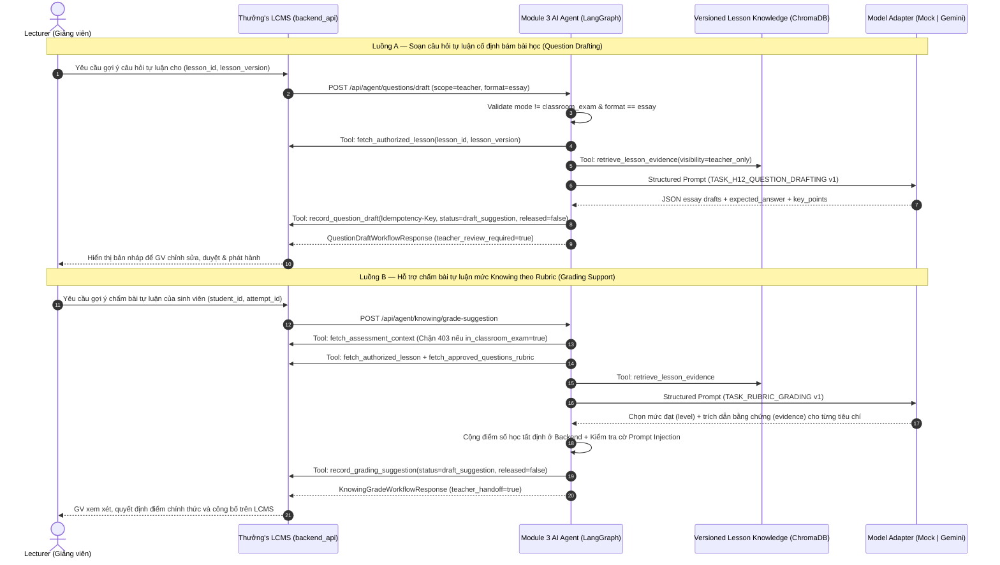
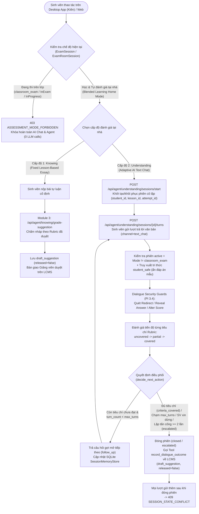

# Tài liệu Tổng hợp & Đối chiếu Khóa luận H12 (AI Agent Development)

> **Văn bản gốc đối chiếu (100% không bỏ sót):** `Proposal_H12_DTC235210055_Duong_Quoc_Toan_en.pdf` (Mục 1 → Mục 9)  
> **Sinh viên thực hiện (Mục 1):** Dương Quốc Toản — MSSV: `DTC235210055` — Lớp: `CNTT K22B QT`  
> **Giảng viên hướng dẫn (Mục 2):** TS. Nguyễn Toàn Thắng (*Faculty of Information Technology, Department of Networks and Information Security* — ĐT: `0987.505.245` — Email: `thangnt@ictu.edu.vn`)  
> **Tên đề tài chính thức (Mục 3):** *Development of an AI Agent Module for an LMS/LCMS Supporting Blended Learning at the Academy of International Education*  
> **Thời gian thực hiện (Mục 4):** 10 tuần (`10 weeks`)

---

## 1. Đối chiếu Mục 5 (Objectives) & Mục 7a (Product Requirements)

### 1.1. Ba Mục tiêu cốt lõi của Đề tài (Mục 5 — Objectives)

| STT | Mục tiêu trong Đề cương H12 (Nguyên văn tiếng Anh) | Hiện thực hóa trong `module3-ai-agent` |
|---:|---|---|
| **1** | *Analyze teacher question-generation/grading workflows and two-level home assessment: **Knowing** through fixed lesson-based essay questions and **Understanding** through adaptive AI text chat.* | Mô hình hóa và thực thi rõ 3 luồng vai trò (`question_drafting`, `grading_support`, `dialogue_assessment`) trong `app/h12_agent/policy.py`, `question_drafting.py`, `knowing_grading.py`, `understanding_dialogue.py`. Khóa cứng định dạng Knowing = `essay` cố định và Understanding = `text_chat` thích ứng; chặn `multiple_choice`/`true_false`/`quiz` và `voice`/`oral` (`422 UNSUPPORTED_ASSESSMENT_FORMAT`). |
| **2** | *Design and implement an AI agent module integrating an LLM, authorized LCMS tools, lesson knowledge and isolated assessment-session memory.* | Tích hợp `langgraph==1.2.24` (`app/h12_agent/graph.py`), `AgentModelAdapter` (`model_adapter.py`), 6 Authorized LCMS Tools (`lcms_tools.py`, `tool_executor.py`), tri thức bài học có phiên bản & phân quyền `student_safe`/`teacher_only` (`knowledge.py`), và bộ nhớ phiên SQLite cô lập theo `(student_id, lesson_id, attempt_id)` (`session_store.py`). |
| **3** | *Evaluate question quality, scoring support, dialogue assessment and controlled integration with the LCMS and student desktop application using documented evidence.* | Bộ dữ liệu chuẩn 36 kịch bản đa bài học (`tests/golden/h12_eval_dataset.json`) và trình chạy đánh giá 6 tiêu chí (`scripts/evaluate_h12.py`), cầu nối HTTP `camelCase` với LCMS Simulator (`lcms_simulator.py`), cùng tích hợp thực tế với `backend_api` (Thưởng) và `student_desktop_app` (Kiên). |

### 1.2. Sáu Sản phẩm bàn giao bắt buộc (Mục 7a — Product Summary & Deliverables)

| STT | Sản phẩm bàn giao theo Mục 7a | Thành phần thực tế trong `module3-ai-agent` |
|---:|---|---|
| **1** | **The agent service** (*Dịch vụ AI Agent*) | Dịch vụ FastAPI + LangGraph (`app/main.py`, `app/api/agent_h12.py`, `app/h12_agent/*`) chạy trên cổng `8003`. |
| **2** | **Tool/API contracts** (*Hợp đồng giao tiếp Tool & API*) | `docs/INTEGRATION_CONTRACT.md` (Section 0), `app/h12_agent/lcms_tools.py`, `app/h12_agent/types.py`. |
| **3** | **Knowledge/session design** (*Thiết kế tri thức bài học & bộ nhớ phiên*) | `app/h12_agent/knowledge.py` (versioned knowledge + visibility scope) & `app/h12_agent/session_store.py` (SQLite isolated sessions + context retention policy). |
| **4** | **Evaluation evidence** (*Bằng chứng đánh giá thực nghiệm*) | `tests/golden/h12_eval_dataset.json`, `scripts/evaluate_h12.py`, `reports/h12_evaluation_offline.md`, `reports/h12_evaluation_offline.json`. |
| **5** | **Runnable demonstration** (*Bản chạy thử nghiệm/demo*) | Chế độ `--mode mock` (offline 100% có nhãn `[MOCK]`) và `--mode gemini` (live Gemini API), kèm `app/h12_agent/lcms_simulator.py` và `Dockerfile` / `docker-compose.yml`. |
| **6** | **Technical documentation** (*Tài liệu kỹ thuật & tích hợp*) | `README.md`, `docs/INTEGRATION_CONTRACT.md`, `docs/INTEGRATION_SYNC_LCMS_DESKTOP.md`, `docs/SECURITY.md`, `docs/ROADMAP_H12.md`, `docs/THESIS_H12_GUIDE.md`. |

---

## 2. Cấu trúc Chuẩn 4 Chương Báo cáo Khóa luận (Đúng Mục 8 của Đề cương H12)

> [!IMPORTANT]
> Mục 8 (*Report requirements*) của `Proposal_H12_DTC235210055_Duong_Quoc_Toan_en.pdf` quy định chính xác tên tiếng Anh của **4 chương báo cáo** như bảng dưới đây. Khi viết quyển báo cáo tốt nghiệp, phải giữ đúng 4 tiêu đề chương này (không tự ý đổi Chương 1 thành Problem Analysis).

| Chương theo Mục 8 Đề cương H12 | Nội dung chi tiết cần trình bày trong báo cáo | Tài liệu & Mã nguồn đối chiếu trong `module3-ai-agent` |
|---|---|---|
| **Chapter 1. AI Agent Foundations and Technologies** *(Present the technical foundations of an AI agent system.)* | 1.1. Tổng quan về hệ thống AI Agent trong giáo dục kết hợp (*Blended Learning*) và sự khác biệt giữa Stateful Tool-Using Agent với Stateless LLM/RAG. 1.2. Kiến trúc điều phối đồ thị trạng thái (*State-Graph Agent Framework* — `LangGraph`) và cơ chế gọi công cụ có ủy quyền (*Authorized Tool Calling*). 1.3. Cơ sở lý thuyết về Retrieval-Augmented Generation (RAG), Vector Database (`ChromaDB`), Embedding (`gemini-embedding-001`) và kiểm soát ngữ cảnh có phiên bản. 1.4. Kiểm soát đầu ra có cấu trúc (*Structured Output Validation*), quản trị phiên bản Prompt (`prompt_registry.py`) và nguyên lý phòng chống tấn công thao túng hội thoại (*Prompt Injection, Answer-Key Leakage, Cross-Session Leakage*). | `app/h12_agent/graph.py`, `app/core/prompt_registry.py`, `app/core/prompts.py`, `app/services/llm_service.py`, `app/services/embedding_service.py`, `app/repositories/chroma_repository.py`, `app/core/output_guard.py` |
| **Chapter 2. Problem Analysis and AI Agent System Design** *(CLO 1 = 20% & CLO 2 = 30%)* | 2.1. Phân tích bài toán Blended Learning tại Academy of International Education và ranh giới giữa AI Agent với các chức năng tất định của LCMS (**PI 1.1**): Knowing = tự luận cố định (*fixed lesson-based essay*), Understanding = chat văn bản thích ứng (*adaptive text chat*), cấm trắc nghiệm & voice/oral. 2.2. Mô hình hóa quy trình nghiệp vụ của Giảng viên (soạn đề → duyệt → phát hành → chấm điểm) và Sinh viên (nhận bài → nộp tự luận Knowing → hội thoại Understanding → đóng phiên → nhận phản hồi), bao gồm cơ chế phục hồi lỗi và **cấm sử dụng trong kỳ thi có kiểm soát trên lớp (`classroom_exam`)** (**PI 1.2**). 2.3. Định nghĩa trách nhiệm, quyền hạn (`CallerScope`), công cụ được phép (`allowed_tools`), điều kiện dừng (`StoppingReason`), chuyển giảng viên (`escalation`) và ranh giới **`draft_suggestion` vs `released results`** cho 3 vai trò `question_drafting`, `grading_support`, `dialogue_assessment` (**PI 1.3**). 2.4. Thiết kế kiến trúc 5 lớp của Module 3 AI Agent (**PI 2.1**) và hợp đồng 6 Authorized Tools/APIs kết nối LCMS có định danh ổn định (`InstitutionalRef`), `X-Agent-Service-Key`, `Idempotency-Key` (**PI 2.2**). 2.5. Thiết kế Tri thức bài học có phiên bản (`lesson_id`, `knowledge_version`, `student_safe` vs `teacher_only`) và Bộ nhớ phiên SQLite cô lập theo `(student_id, lesson_id, attempt_id)` kèm chính sách lưu giữ/cắt tỉa ngữ cảnh (**PI 2.3**). | `PHAN_TICH_DOI_CHIEU_DE_CUONG_H12.md`, `app/h12_agent/types.py`, `app/h12_agent/policy.py`, `app/h12_agent/lcms_tools.py`, `app/h12_agent/tool_executor.py`, `app/h12_agent/idempotency.py`, `app/h12_agent/knowledge.py`, `app/h12_agent/session_store.py`, `docs/INTEGRATION_CONTRACT.md` |
| **Chapter 3. AI Agent System Implementation** *(CLO 3 = 40%)* | 3.1. Lựa chọn & biện minh framework `langgraph==1.2.24`, cấu hình tái lập (`runtime_config.py`) và tầng `AgentModelAdapter` thay thế được (`DeterministicMockModelAdapter` có nhãn `[MOCK]` vs `LiveGeminiModelAdapter`) (**PI 3.1**). 3.2. Tích hợp LLM qua hệ thống Prompt có cấu trúc & khóa SHA-256 (`TASK_H12_QUESTION_DRAFTING`, `TASK_RUBRIC_GRADING`, `TASK_H12_UNDERSTANDING_TURN`), xác thực JSON Schema nghiêm ngặt, xử lý lỗi dịch vụ/câu trả lời dị dạng/giới hạn ngữ cảnh mà không bịa điểm (**PI 3.2**). 3.3. Hiện thực hóa 6 Authorized Tool Calls nối LCMS (`HttpLcmsToolClient` & `MockLcmsToolClient`) và 3 workflow điều phối bằng LangGraph (**PI 3.3**):   - *Workflow 1:* Soạn câu hỏi tự luận bám bài giảng & bàn giao LCMS (`question_drafting.py`).   - *Workflow 2:* Hỗ trợ chấm bài tự luận mức Knowing theo rubric & bàn giao giảng viên (`knowing_grading.py`).   - *Workflow 3:* Hội thoại văn bản thích ứng mức Understanding đa lượt & đóng phiên (`understanding_dialogue.py`). 3.4. Luồng kiểm soát đa bước (*Controlled Workflow*), ghi vết hành động quan sát được (`observable_steps`, `tool_outcomes`, `h12_tool_audit`) và bộ chốt chặn bảo mật hội thoại (`dialogue_guards.py`): chống lái hướng (*redirect*), chống lộ đáp án (*reveal answers*), chống sửa điểm (*alter scores*) và chặn chat tiếp sau khi đóng phiên (*continue after closure*) (**PI 3.4**). | `app/h12_agent/graph.py`, `app/h12_agent/model_adapter.py`, `app/h12_agent/question_drafting.py`, `app/h12_agent/knowing_grading.py`, `app/h12_agent/understanding_dialogue.py`, `app/h12_agent/dialogue_guards.py`, `app/api/agent_h12.py`, `app/grading/grader.py`, `app/grading/policy.py` |
| **Chapter 4. System Evaluation and Deployment** *(CLO 4 = 10%)* | 4.1. Thiết kế bộ dữ liệu đánh giá đa bài học (`tests/golden/h12_eval_dataset.json`, 36 kịch bản) và phương pháp đo lường 6 tiêu chí bắt buộc (**PI 4.1**): *(1) question relevance, (2) lesson grounding, (3) rubric coverage, (4) scoring agreement, (5) Understanding follow-up quality, (6) failure handling*, kèm kiểm thử *prompt-injection* và *cross-session isolation*. 4.2. Phân tích kết quả thực nghiệm (`reports/h12_evaluation_offline.md`) và thảo luận trung thực các hạn chế hiện tại. 4.3. Đóng gói triển khai dịch vụ (`Dockerfile`, `docker-compose.yml`, `render.yaml`), bảo mật thông tin xác thực model (`docs/SECURITY.md`), hướng dẫn cài đặt & sử dụng, và bằng chứng tích hợp hai chiều với **LCMS của Thưởng (`backend_api`)** cùng **Desktop Client của Kiên (`student_desktop_app`)** (**PI 4.2**). | `tests/golden/h12_eval_dataset.json`, `scripts/evaluate_h12.py`, `reports/h12_evaluation_offline.md`, `app/h12_agent/lcms_simulator.py`, `docs/INTEGRATION_SYNC_LCMS_DESKTOP.md`, `docs/SECURITY.md`, `Dockerfile`, `docker-compose.yml`, `tests/test_h12_milestone1..6.py` |

---

## 3. Sơ đồ Kiến trúc & Quy trình Nghiệp vụ Chuẩn H12 (Phục vụ Chương 2 & Chương 3)

### 3.1. Sơ đồ Luồng Hỗ trợ Giảng viên (Soạn câu hỏi Tự luận & Hỗ trợ Chấm bài Knowing — PI 1.2, PI 1.3, PI 3.3)

### 3.2. Sơ đồ Luồng Sinh viên Tự đánh giá tại nhà (Knowing & Understanding) và Chốt chặn Chế độ Thi trên lớp (PI 1.2, PI 2.3, PI 3.4)

---

## 4. Bảng Đối chiếu Chi tiết 4 CLO & 12 Chỉ số PI (Mục 6 & Mục 7b — Tổng 100%)

| CLO & Trọng số | Mã PI (% điểm) | Yêu cầu tối thiểu trong Đề cương H12 (Mục 7b) | Cách `module3-ai-agent` đáp ứng đầy đủ | Bằng chứng Mã nguồn & Kiểm thử |
|---|---:|---|---|---|
| **CLO 1 (20%)** Analyze problem & identify requirements | **PI 1.1 (5%)** | Chỉ định rõ chỗ dùng Agent/Tool cho soạn đề bám bài, hỗ trợ chấm, chat Understanding vs hàm LCMS tất định. Knowing = **essay cố định**, Understanding = **text chat** (*cấm thay bằng MCQ hoặc voice*). | `policy.py` tách rõ 3 vai trò Agent; điểm số luôn cộng tất định ở backend (`grader.py`); khóa cứng Knowing = `essay` và Understanding = `text_chat`; từ chối `multiple_choice`/`true_false`/`quiz` và `voice`/`oral` với `422 UNSUPPORTED_ASSESSMENT_FORMAT`. | `app/h12_agent/policy.py`, `tests/test_h12_milestone1.py`, `tests/test_h12_milestone3.py`, `tests/test_h12_milestone4.py` |
| **CLO 1 (20%)** | **PI 1.2 (5%)** | Mô hình hóa quy trình GV (soạn/duyệt/phát hành/chấm) & SV (nhận bài, nộp essay, lượt chat, đóng phiên, phản hồi), gồm truy xuất ủy quyền, gọi tool, kiểm duyệt, GV duyệt, phục hồi lỗi và **cấm dùng khi thi trên lớp**. | Đầy đủ sơ đồ và state machine cho cả 3 luồng; phục hồi an toàn khi LLM trả JSON lỗi (`502` mà không làm hỏng phiên active); chặn cứng `classroom_exam` cả ở Module 3 lẫn `StudentController.cs` / `StudentAiController.cs` (`403 ASSESSMENT_MODE_FORBIDDEN`). | `app/h12_agent/knowing_grading.py`, `app/h12_agent/understanding_dialogue.py`, `tests/test_h12_milestone4.py`, `tests/test_h12_milestone5.py` |
| **CLO 1 (20%)** | **PI 1.3 (10%)** | Định nghĩa trách nhiệm & quyền hạn của `question-drafting`, `grading-support`, `dialogue-assessment`; chỉ rõ allowed tools, stopping conditions, escalation và **`draft_suggestion` vs `released results`**. | `ROLE_POLICIES` định nghĩa chặt `allowed_caller_scopes`, `allowed_modes`, `allowed_tools`, `visibility_scope`, 4 `StoppingReason` (`criteria_covered`, `max_turns_reached`, `student_requested_closure`, `repeated_injection_escalation`); mọi response đều khóa `publication_status="draft_suggestion"`, `released=False`, `teacher_review_required=True`. | `app/h12_agent/policy.py`, `app/h12_agent/types.py`, `tests/test_h12_milestone1.py`, `tests/test_h12_milestone3.py` |
| **CLO 2 (30%)** Design architecture & components | **PI 2.1 (15%)** | Thiết kế kiến trúc Agent nối dịch vụ LCMS, LLM, thực thi tool, tầng tri thức bài học và phiên theo từng SV; tách rõ ranh giới dữ liệu trường, ngữ cảnh model, điều phối hội thoại và hậu kiểm; dùng mock khi tích hợp chưa sẵn sàng. | Kiến trúc 5 lớp tách biệt: API Gateway (`agent_h12.py`) → LangGraph Orchestrator (`question_drafting.py`, `knowing_grading.py`, `understanding_dialogue.py`) → `AuthorizedToolExecutor` (`tool_executor.py`) → `LessonKnowledgeService` & `SessionMemoryStore` → `AgentModelAdapter` & `LCMSToolClient` (`mock` \| `http`). | `app/h12_agent/`, `docs/INTEGRATION_CONTRACT.md` |
| **CLO 2 (30%)** | **PI 2.2 (10%)** | Đặc tả tools/APIs lấy bài học, câu hỏi/rubric, ngữ cảnh đánh giá và ghi gợi ý/kết quả hội thoại. Có **stable IDs, schemas, auth scope, failure responses, repeated-request handling**; cấm truy cập không giới hạn & tự công bố điểm. | 6 tools chuẩn hóa sử dụng `InstitutionalRef` ổn định (`lesson_id`, `lesson_version`, `student_id`, `attempt_id`, `rubric_id`), kiểm tra `X-Agent-Service-Key` (`401`), scope (`403`), `Idempotency-Key` SHA-256 (`409 IDEMPOTENCY_KEY_CONFLICT`), không có endpoint nào cho phép publish điểm. | `app/h12_agent/lcms_tools.py`, `app/h12_agent/idempotency.py`, `tests/test_h12_milestone2.py` |
| **CLO 2 (30%)** | **PI 2.3 (5%)** | Thiết kế **tri thức có phiên bản** từ học liệu & rubric đã duyệt + **bộ nhớ phiên cô lập theo `(student, lesson, attempt)`**, lưu evidence refs, có retention/context policy; **ngăn lộ answer key hoặc hội thoại của SV khác**. | ChromaDB lọc theo `(lesson_id, knowledge_version, visibility)` tách `student_safe` khỏi `teacher_only` (chặn `UNAPPROVED_KNOWLEDGE` `422`); SQLite `SessionMemoryStore` khóa theo `(student_id, lesson_id, attempt_id)`, cắt cửa sổ ngữ cảnh `build_model_context` và dọn hạn `purge_expired_sessions`. | `app/h12_agent/knowledge.py`, `app/h12_agent/session_store.py`, `tests/test_h12_milestone2.py`, `tests/test_h12_milestone5.py` |
| **CLO 3 (40%)** Implement AI agent integrating LLM & tools | **PI 3.1 (5%)** | Chọn & biện minh Agent Framework; cấu hình tái lập với model adapter thay thế được; cung cấp dịch vụ & test harness **phân biệt rõ mock response với actual model response**. | Sử dụng `langgraph==1.2.24`; `AGENT_MODEL_ADAPTER=mock\|gemini` chuyển đổi giữa `DeterministicMockModelAdapter` (gắn tiền tố `[MOCK]`, `is_mock=True`) và `LiveGeminiModelAdapter` (`is_mock=False`), trả header `X-AI-Adapter-Mode` và `X-AI-Framework: langgraph`. | `app/h12_agent/graph.py`, `app/h12_agent/model_adapter.py`, `tests/test_h12_milestone1.py` |
| **CLO 3 (40%)** | **PI 3.2 (5%)** | Tích hợp LLM qua **structured prompts & validated output schemas** cho question drafts, rubric suggestions, dialogue turns; xử lý lỗi dịch vụ, câu trả lời dị dạng, giới hạn ngữ cảnh mà không bịa điểm hay tự hoàn thành phiên. | Toàn bộ prompt H12 (`TASK_H12_QUESTION_DRAFTING`, `TASK_RUBRIC_GRADING`, `TASK_H12_UNDERSTANDING_TURN`) được đăng ký, kiểm tra lint bảo mật và khóa SHA-256 trong `prompt_registry.py`; kiểm tra JSON schema nghiêm ngặt, retry có kiểm soát và fail-closed (`502`/`503`). | `app/core/prompts.py`, `app/core/prompt_registry.py`, `app/h12_agent/question_drafting.py`, `knowing_grading.py`, `understanding_dialogue.py` |
| **CLO 3 (40%)** | **PI 3.3 (20%)** | Hiện thực hóa **authorized tool calls** nối dịch vụ lesson/rubric/assignment & result-suggestion của LCMS; trình diễn đủ: question drafting, Knowing assessment, Understanding text dialogue qua tích hợp client/LCMS hoặc documented mocks. | `AuthorizedToolExecutor` kiểm soát quyền trước mọi lệnh gọi tới `HttpLcmsToolClient` / `MockLcmsToolClient`; kiểm chứng end-to-end cả 3 luồng qua HTTP bridge với `create_lcms_simulator_app` (`camelCase`) và `backend_api`. | `app/h12_agent/tool_executor.py`, `app/h12_agent/lcms_simulator.py`, `tests/test_h12_milestone3.py`, `tests/test_h12_milestone4.py`, `tests/test_h12_milestone5.py` |
| **CLO 3 (40%)** | **PI 3.4 (10%)** | Luồng điều phối có kiểm soát: validate mode & session → retrieve evidence → select allowed tools → evaluate answer → follow-up hoặc close session. Ghi observable actions, evidence, tool outcomes; test **redirect, reveal answers, alter scores, continue after closure**. | Đồ thị LangGraph ghi đầy đủ `observable_steps`, `evidence_refs`, `tool_outcomes` và bảng `h12_tool_audit`; vượt qua trọn bộ 4 bài kiểm thử tấn công hội thoại trong `dialogue_guards.py` mà không phụ thuộc vào chuỗi suy luận ẩn của model. | `app/h12_agent/dialogue_guards.py`, `app/h12_agent/understanding_dialogue.py`, `tests/test_h12_milestone4.py` |
| **CLO 4 (10%)** Evaluate, test & deploy | **PI 4.1 (5%)** | Bộ đánh giá được GVHD duyệt cho **6 tiêu chí** (*question relevance, lesson grounding, rubric coverage, scoring agreement, Understanding follow-up quality, failure handling*), kèm **prompt-injection** & **cross-session isolation tests**. | Tập dữ liệu chuẩn `tests/golden/h12_eval_dataset.json` (36 kịch bản trên 4 bài học đã duyệt + 1 bài chưa duyệt) có quy định rõ `agreed_dataset_size` và `acceptance_thresholds`; script `scripts/evaluate_h12.py` xuất báo cáo Markdown & JSON. | `tests/golden/h12_eval_dataset.json`, `scripts/evaluate_h12.py`, `reports/h12_evaluation_offline.md`, `tests/test_h12_milestone6.py` |
| **CLO 4 (10%)** | **PI 4.2 (5%)** | Triển khai agent service kèm cấu hình, giới hạn vận hành; demo hỗ trợ GV và 2 mức đánh giá tại nhà; cung cấp hướng dẫn cài đặt/sử dụng và bằng chứng tích hợp với **LCMS của Thưởng** & **Desktop client của Kiên**; không nhúng credential model vào client. | Đóng gói `Dockerfile`, `docker-compose.yml`, `render.yaml`, tài liệu `README.md`, `INTEGRATION_CONTRACT.md`, `INTEGRATION_SYNC_LCMS_DESKTOP.md`, `SECURITY.md`; kiểm tra tự động không lộ API key trong code/client (`test_security.py`). | `Dockerfile`, `docker-compose.yml`, `docs/INTEGRATION_SYNC_LCMS_DESKTOP.md`, `docs/SECURITY.md`, `tests/test_h12_milestone6.py` |

---

## 5. Đối chiếu Lịch trình 10 Tuần (Mục 9 — Work Schedule, Weeks 1 → 10)

| Tuần | Nhiệm vụ trong Đề cương H12 (Tasks) | Kết quả yêu cầu (Expected Results) | Sản phẩm đã hoàn thành trong Dự án |
|:---:|---|---|---|
| **Week 1** | *Analyze teacher support and Knowing/Understanding workflows; confirm text-based dialogue and agent responsibilities.* | *Agent requirements, role boundaries and assessment workflow diagrams.* | `PHAN_TICH_DOI_CHIEU_DE_CUONG_H12.md`, `docs/THESIS_H12_GUIDE.md` (Sơ đồ Mục 3.1 & 3.2), `app/h12_agent/policy.py`, `app/h12_agent/types.py`. |
| **Week 2** | *Specify shared APIs, permission scopes, dialogue/session states and evaluation criteria.* | *Tool contracts, assessment-state design and evaluation plan.* | `docs/INTEGRATION_CONTRACT.md` (Section 0), `app/h12_agent/lcms_tools.py`, `app/h12_agent/idempotency.py`, `tests/golden/h12_eval_dataset.json`. |
| **Week 3** | *Design agent architecture, lesson knowledge organization and isolated session memory.* | *Architecture, knowledge/memory design and structured response schemas.* | `app/h12_agent/knowledge.py`, `app/h12_agent/session_store.py`, `app/repositories/chroma_repository.py`, `tests/test_h12_milestone2.py`. |
| **Week 4** | *Select framework/model approach and implement replaceable model adapter and authorized retrieval tools.* | *Runnable agent skeleton with labeled mocks and retrieval tests.* | `app/h12_agent/graph.py` (`langgraph==1.2.24`), `app/h12_agent/model_adapter.py`, `app/h12_agent/tool_executor.py`, `tests/test_h12_milestone1.py`. |
| **Week 5** | *Implement lesson-grounded question drafting and teacher review handoff.* | *Question-draft workflow with evidence references and validation.* | `app/h12_agent/question_drafting.py` (`POST /api/agent/questions/draft`), `TASK_H12_QUESTION_DRAFTING`, `tests/test_h12_milestone3.py`. |
| **Week 6** | *Implement rubric-based grading support for fixed Knowing essay answers.* | *Scoring suggestions with criterion-linked feedback and teacher handoff.* | `app/h12_agent/knowing_grading.py` (`POST /api/agent/knowing/grade-suggestion`), `app/grading/policy.py` (`knowing_essay`), `tests/test_h12_milestone3.py`. |
| **Week 7** | *Implement adaptive Understanding text chat, follow-up selection and session closure.* | *End-to-end dialogue sessions and recorded assessment evidence.* | `app/h12_agent/understanding_dialogue.py` (`/sessions/start`, `/turns`, `/close`), `app/h12_agent/dialogue_guards.py`, `TASK_H12_UNDERSTANDING_TURN`, `tests/test_h12_milestone4.py`. |
| **Week 8** | *Integrate teacher services with LCMS and dialogue services with desktop client.* | *Integrated workflows, session isolation and classroom-mode denial tests.* | `app/h12_agent/lcms_simulator.py`, `docs/INTEGRATION_SYNC_LCMS_DESKTOP.md`, `backend_api/Controllers/StudentController.cs` & `StudentAiController.cs`, `student_desktop_app/ExamForm.cs`, `tests/test_h12_milestone5.py`. |
| **Week 9** | *Run agreed evaluation set, analyze errors and improve constrained workflows.* | *Measured evaluation report and documented unresolved limitations.* | `scripts/evaluate_h12.py`, `reports/h12_evaluation_offline.md`, `reports/h12_evaluation_offline.json`, `tests/test_h12_milestone6.py`. |
| **Week 10** | *Deploy agent demonstration and complete documentation and academic report.* | *Runnable module, tool/API guides, test evidence and final draft report.* | `Dockerfile`, `docker-compose.yml`, `scripts/release_check.py`, `README.md`, `docs/SECURITY.md`, `docs/THESIS_H12_GUIDE.md`. |

---

## 6. Kết quả Đánh giá Thực nghiệm Offline (`mock` Adapter) & Live (`gemini` Adapter — PI 4.1)

Trích từ [`reports/h12_evaluation_offline.md`](file:///c:/Users/ADMIN/source/repos/ICTU_AI_LearningSystem/module3-ai-agent/reports/h12_evaluation_offline.md) (`adapter_mode=mock`, `is_mock=true`, thời gian `0.62s`) và [`reports/h12_evaluation_gemini.md`](file:///c:/Users/ADMIN/source/repos/ICTU_AI_LearningSystem/module3-ai-agent/reports/h12_evaluation_gemini.md) (`adapter_mode=live`, `is_mock=false`, model `gemini-3.5-flash-lite` + `gemini-embedding-001`, thời gian `147.36s`), chạy hoàn toàn qua HTTP giữa FastAPI Module 3 và LCMS Simulator `camelCase`:

- **Bộ dữ liệu:** [`tests/golden/h12_eval_dataset.json`](file:///c:/Users/ADMIN/source/repos/ICTU_AI_LearningSystem/module3-ai-agent/tests/golden/h12_eval_dataset.json) (`v1.0.0`, 36 kịch bản trên 4 bài học đã duyệt: `lesson-db-01@v1`, `lesson-db-01@v2`, `lesson-se-02@v1`, `lesson-net-03@v1`, cùng bài chưa duyệt `lesson-draft-99@v1`).

| # | Tiêu chí PI 4.1 | Ngưỡng chấp nhận | Kết quả Offline (`--mode mock`) | Kết quả Live LLM (`--mode gemini`) | Trạng thái |
|---:|---|---|---|---|---|
| **1** | `question_relevance` | `>= 90%` | `6/6` (`100.0%`) | `6/6` (`100.0%`) | **PASS** |
| **2** | `lesson_grounding` | `>= 100%` | `6/6` (`100.0%`) | `6/6` (`100.0%`) | **PASS** |
| **3** | `rubric_coverage` | `>= 100%` | `4/4` (`100.0%`) | `4/4` (`100.0%`) | **PASS** |
| **4** | `scoring_agreement` | `MAE <= 1.5`, `status >= 90%` | `MAE = 0.0`, `status = 100.0%` (`8/8`) | `MAE = 0.0`, `status = 100.0%` (`8/8`) | **PASS** |
| **5** | `understanding_followup_quality` | `>= 90%` (`PI 3.4 sec >= 100%`) | `6/6` (`100.0%`), `sec = 100.0%` | `6/6` (`100.0%`), `sec = 100.0%` | **PASS** |
| **6** | `failure_handling` | `>= 100%` | `6/6` (`100.0%`) | `6/6` (`100.0%`) | **PASS** |

- **Bất biến toàn cục (trên cả `mock` và `live`):** `zero_silent_grade_publication = True`, `zero_answer_key_leakage = True`, `overall_passed = True`.

---

## 7. Hạn chế Cần Trình bày Trung thực Khi Bảo vệ (PI 4.1)

1. **Phạm vi kết quả `--mode mock` vs `--mode gemini`:** Kết quả trong `reports/h12_evaluation_offline.md` kiểm chứng tính đúng đắn của kiến trúc Agent, tool calls, rẽ nhánh LangGraph, chính sách `student_safe`, cô lập phiên và xử lý lỗi mà không phụ thuộc kết nối mạng. Khi demo live hoặc đo chất lượng diễn đạt tự nhiên trên `live` LLM, chạy `python scripts/evaluate_h12.py --mode gemini` với `GEMINI_API_KEY` hợp lệ và lưu ý giới hạn tốc độ (*rate limit*) của gói Gemini API đang dùng.
2. **Ranh giới giữa Module 3 và LCMS / Desktop Client:** Toàn bộ mã nguồn lõi AI Agent nằm trong `module3-ai-agent/`. Phần kết nối phía C# (`backend_api` của Thưởng và `student_desktop_app` của Kiên) đã được đồng bộ khóa cứng chế độ thi trên lớp (`403 ASSESSMENT_MODE_FORBIDDEN`) trên nhánh tích hợp `ai-integration` và được mô phỏng HTTP hai chiều tương thích ASP.NET Core `camelCase` qua `app/h12_agent/lcms_simulator.py`.
3. **Các endpoint legacy giữ lại để tương thích ngược:** Các route phục vụ giai đoạn thử nghiệm ban đầu (`/api/evaluations/evaluate`, `/api/questions/generate-matrix`, `/api/submissions/handwritten/transcribe`) vẫn được giữ ở tầng tương thích ngược để không làm gãy các test cũ (`test_api_contract.py`), trong khi toàn bộ luồng đồ án H12 vận hành qua nhóm endpoint `/api/agent/*`.
